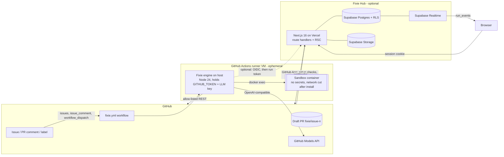
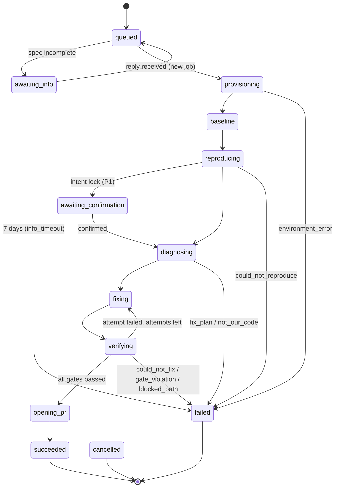

# Fixie — Technical Requirements Document (v2.0)

Oct 31, 2026 · @Mahajan Sarthak Dileep · Team MisfitMinds · Companion to PRD v2.0 · Supersedes "TRD — PatchPilot v1.0" · Vocabulary: `00_START_HERE.md` §4

## 1. Overview

Fixie is one TypeScript engine shipped three ways: a GitHub Action (primary), a CLI, and an optional web app (Fixie Hub). The engine runs on the repo's own GitHub Actions runner (or a developer's machine), executes repo code only inside a locked Docker container, talks to any OpenAI-compatible model, and enforces every gate in code. The Hub is Next.js 16 on Vercel with Supabase (Postgres, Auth, Realtime, Storage, pg_cron) and a read-only GitHub App.

**Design principles.**

1. **Tools think, the model writes.** Deterministic tools (JUnit parsing, coverage, bisect, tree-sitter, linters, scanners) produce evidence and decisions; the model only produces a bug spec, a repro test, hypotheses, a patch and an explanation, each through a narrow, validated text protocol.
2. **The model proposes; code verifies.** Gate results come from exit codes and parsed reports, never from model output.
3. **Untrusted by default.** Repo code, issue text, comments, test output and model output are all hostile input.
4. **Free by default.** Every required component runs on free tiers: GitHub-hosted runners, GitHub Models, Ollama, Vercel Hobby, Supabase Free.
5. **One source of truth per thing.** Engine config in `.fixie.yml`; run evidence in the trace (and mirrored to the Hub); identity and access from GitHub.

**Constraints.** Hackathon build by a team of four; Python (pytest) and JS/TS (Vitest, Jest); runners are `ubuntu-latest` (public repos: 4 vCPU, 16 GB RAM, 14 GB SSD; private: 2 vCPU, 8 GB); default model free tier with small context windows; Node 24 action runtime.

## 2. System architecture



**Components.**

| Component | Package / location | Runs on | Responsibility |
| --- | --- | --- | --- |
| Engine | `packages/engine` | Runner host or dev machine | Pipeline, state machine, prompts, localisation, bisect, checkpoints, gates, Proof Card, reports |
| Sandbox | `packages/sandbox` | Host, drives Docker | `SandboxProvider` interface; `DockerProvider` (P0), `E2BProvider` (P2) |
| LLM | `packages/llm` | Host | Presets, OpenAI-compatible client, context budgeting, cost table, retries, fallback |
| GitHub | `packages/github` | Host and Hub | Allow-listed Octokit wrapper, templates GH-01…GH-10, state markers, ruleset check |
| Shared | `packages/shared` | Everywhere | Zod schemas: `.fixie.yml`, events, trace manifest, Proof Card, enums, labels, problem types |
| CLI | `packages/cli` | Dev machine, Actions | `fixie init`, `doctor`, `run`, `replay`, `sweep` |
| Action | `action.yml` + `action/dist/index.js` | Actions (`node24`) | Thin wrapper: reads inputs, runs `fixie run` / `doctor` / `sweep` in CI mode, uploads trace |
| Hub | `apps/hub` | Vercel | Dashboard, `/api/v1`, ingest API, GitHub webhooks, cron endpoints |
| Database | `supabase/` | Supabase | Migrations, seed, RLS, SQL functions, pg_cron jobs, storage buckets |

**Run data flows.**

*Action-only (no Hub).* Label → workflow → engine → sandbox → GitHub comments/PR → trace uploaded as a workflow artifact → Proof Card also written to the job summary.

*With Hub.* Same, plus: at start the engine requests a GitHub OIDC token and calls `POST /api/ingest/v1/runs`; the Hub checks installation gating and returns a run id and a run-scoped ingest token; the engine batches events every second to `/events`; browsers subscribed via Realtime see them within ~1 s; command logs upload to Storage through signed upload URLs; `/complete` closes the run; `workflow_run.completed` webhooks reconcile anything the engine could not report.

*Dashboard dispatch.* Hub generates a run UUID, calls the workflow dispatch API with `inputs.fixie_run_id` and `return_run_details: true`, stores the returned `workflow_run_id`, and inserts the run row as `queued`. The engine attaches to that run on its first ingest call.

*CLI.* `fixie run` runs the same pipeline against a local clone with local Docker; it posts to GitHub only with `--publish` (using a token from `GITHUB_TOKEN` or `gh auth token`) and never reports to the Hub in v1.

## 3. Engine pipeline

The engine is a deterministic state machine. Each step writes `step.started` / `step.finished` events and moves `runs.status`. Steps call the model only where marked **[LLM Tn]**.

| # | Step (`run_step`) | Status during step | What happens | Exit on failure |
| --- | --- | --- | --- | --- |
| 0 | (gating) | — | Checks in PRD F2 order; first failure posts GH-01 and exits without a run (Hub: ingest returns `allowed: false`) | No run |
| 1 | `bug_spec` | `queued` | Parse stack traces and error lines deterministically; **[LLM T1]** fill BugSpec JSON; readiness rule D-22; missing → GH-03, label `fixie:needs-info`, status `awaiting_info`, job ends | `awaiting_info` |
| 2 | `triage` | `queued` | Route tier: T0 if the issue only contains lint/type/format output and an autofixer exists (P1); else T1; T3 decided later | — |
| 3 | `provision` | `provisioning` | Detect language/framework, pick image, create network, start container with limits | `environment_error` / `infra_error` |
| 4 | `install` | `provisioning` | Run install (detected or configured) with network; install Fixie extras (coverage tools) into `/deps`; **disconnect network**; egress probe must fail | `environment_error` |
| 5 | `baseline` | `baseline` | Run full suite with JUnit; record per-test outcomes; run detected lint/type commands for error counts | `environment_error` if suite can't start |
| 6 | `reproduce` | `reproducing` | **[LLM T2]** write repro test file; run it; gate `repro_fails_before`; up to `max_repro_attempts` | `could_not_reproduce` + GH-04 |
| 7 | `confirm_intent` (P1) | `awaiting_confirmation` | Post GH-08 assertion; poll 15 min for 👍; `/fixie confirm` resumes later | — |
| 8 | `bisect` | `diagnosing` | Find good commit; binary search (§3.4) | Never fatal; records status |
| 9 | `localize` | `diagnosing` | Rank suspicious lines (§3.3); decide T3 if needed | `fix_plan` + GH-04 |
| 10 | `hypothesize` | `diagnosing` | **[LLM T3]** one hypothesis (three after two failures) | `could_not_fix` |
| 11 | `fix` | `fixing` | **[LLM T4]** SEARCH/REPLACE edits; policy checks; checkpoint commit | — |
| 12 | `verify` | `verifying` | Repro → impacted tests → full suite → lint/type → gates; rollback rules (§3.5); loop to 10/11 | `could_not_fix`, `gate_violation`, `blocked_path`, `budget_exceeded` |
| 13 | `stress` (P1) | `verifying` | Repro + impacted tests × `stress_runs` with shuffled order/seeds | Low confidence only |
| 14 | `explain` | `opening_pr` | **[LLM T5]** summary, root cause, changes, risk; Proof Card assembled by code | Template fallback |
| 15 | `open_pr` | `opening_pr` | Re-check ruleset; create commit via Git Data API; create draft PR; update status comment and labels | `gate_violation` (ruleset changed) / `infra_error` |
| 16 | `report` | (terminal) | GH-04 for `could_not_reproduce`, `could_not_fix`, `fix_plan`, `not_our_code` | — |
| 17 | `teardown` | (terminal) | Always: remove container and network, finalise status comment, write trace, upload artifact, `/complete` | — |

### 3.1 Run state machine



Any active status may go to `failed` (`budget_exceeded`, `infra_error`) or `cancelled`. Revise runs start at `queued`, skip `awaiting_info`, and end `succeeded/pr_updated`. Invariant: `outcome` is set exactly when status is terminal.

### 3.2 LLM tasks and text protocols

All untrusted text is wrapped as `<untrusted source="issue|comment|file|test_output">…</untrusted>` with a system instruction that it is data, never instructions. Every task has a fixed system prompt in `packages/engine/prompts/` (versioned, unit-snapshot-tested).

| Task | Input (trimmed to the preset's context budget, in priority order) | Output protocol | Validation and retry |
| --- | --- | --- | --- |
| T1 bug spec | Issue title, body, comments (newest last), parsed stack traces | One JSON object `BugSpec` | Zod; one repair retry with the validation error; then deterministic partial spec |
| T2 repro test | BugSpec, framework, path of the new test file, one existing test file as style sample (≤ 120 lines), up to 3 candidate source regions | One fenced code block (whole file) + one JSON line `{testName, assertionInPlainEnglish}` | Must parse (Python `ast`/TS parser run in sandbox), must not import network or time-sleep libraries, must target the new file only |
| T3 hypotheses | BugSpec, repro failure (≤ 60 lines), top-K suspicious regions with scores, bisect diff (≤ 120 lines), previous attempts (summary + signature) | JSON array of `{summary, rationale, files[], confidence}` (length 1, or 3 when asked) | Zod; files must exist and not be blocked |
| T4 patch | Hypothesis, full text of up to 3 target regions with line numbers, repro test, last failure (≤ 60 lines), revise feedback | SEARCH/REPLACE blocks only (format below) | Each SEARCH must match exactly once (exact, then whitespace-normalised); paths must pass policy |
| T5 explain | Final diff, gate evidence summary, accepted hypothesis | JSON `{summary ≤ 60 words, rootCause ≤ 80, changes[{file, why ≤ 25}], risk ≤ 60}` | Zod; Markdown-escaped; on failure a template built from evidence |
| T6 intent (P1) | Repro test code | Covered by T2's `assertionInPlainEnglish` | — |

```text
src/dates/parse.py
<<<<<<< SEARCH
    if month == 2 and day > 28:
        raise ValueError("invalid day")
=======
    if month == 2 and day > (29 if is_leap(year) else 28):
        raise ValueError("invalid day")
>>>>>>> REPLACE
```

Token estimation uses `ceil(chars / 3.5)` (no tokenizer dependency). Each preset defines `contextTokens` and `maxOutputTokens`; the prompt builder drops sections lowest-priority first and never truncates inside a code region.

### 3.3 Fault localisation (deterministic)

`score(line) = 0.40·ochiai + 0.30·stack + 0.20·bisect + 0.10·search`, renormalised over the signals that are available.

- **ochiai:** coverage of the failing repro test vs up to 20 baseline-passing related tests (same test file, or test files importing the stack-trace modules), each run in the sandbox with coverage, capped at 3 minutes. Ochiai = ef / √((ef + nf)(ef + ep)). Python uses `coverage run -m pytest` with `--cov-context=test` style dynamic contexts and `coverage json --show-contexts`; JS/TS uses the V8 coverage provider when the repo's Vitest/Jest supports it, otherwise this signal is skipped.
- **stack:** 1.0 for the deepest in-repo frame, × 0.7 per frame further from the failure; library frames ignored.
- **bisect:** 1.0 for lines inside or within 3 lines of hunks changed by the first bad commit.
- **search:** normalised ripgrep hits for identifiers named in the bug spec and error messages.

Lines are grouped into their enclosing function or class with tree-sitter (`web-tree-sitter` with Python, JavaScript and TypeScript grammars); the top 5 regions (default) go to T3/T4. **Tier 3 rule:** route to `fix_plan` when the top regions span more files than `max_changed_files`, or when the repro only fails with timeouts, concurrency or environment errors that the sandbox can't control.

### 3.4 Auto git-bisect

1. Candidate good commits in order: BugSpec `last_good` (SHA, tag, or version mapped to tags `v{x}` / `{x}`), `.fixie.yml bisect.good`, the newest release tag behind HEAD, then `HEAD~16`, `HEAD~64`, `HEAD~256` (within history).
2. A commit is **dependency-stable** if every manifest and lockfile (`requirements*.txt`, `pyproject.toml`, `poetry.lock`, `uv.lock`, `Pipfile.lock`, `package.json`, `package-lock.json`, `pnpm-lock.yaml`, `yarn.lock`) has the same blob hash as at HEAD. Unstable commits are never tested.
3. Testing a commit: host runs `git checkout --force <sha>` in the work tree (hooks disabled), keeps the untracked repro test file in place, runs only the repro test in the container. Pass → good. Fail with the same error signature → bad. Collection/import error → skip.
4. Binary search over `git rev-list --first-parent <good>..HEAD`, max `bisect.max_steps` (12) and `bisect.max_minutes` (6). The host restores HEAD afterwards.
5. Result `{status: found | no_good_commit | dependency_boundary | timeout | not_applicable, goodSha, firstBadSha, steps, skipped, commit {message, author, date, files}}`. `dependency_boundary` reports the range closest to the dependency change (input for the P1 failure-source classifier).

### 3.5 Checkpoints, rollback and hypothesis switching

- Checkpoints are commits on a local scratch branch `fixie/wip-<runId>` (never pushed): `c0` = HEAD, `c1` = repro test added, then one per attempt.
- After each attempt record `failingTests` (excluding the repro), `errorCount` (new lint + type errors in changed files), and the **error signature** `sha1(normalise(exceptionType + first assertion line + deepest in-repo frame file:function))`, where normalising replaces numbers, hex addresses and temp paths.
- **Rollback rule:** if `failingTests ⊄ baselineFailing` (a test that passed at baseline now fails) or `errorCount > 0` new errors, `git reset --hard` to the previous good checkpoint, mark the checkpoint `reverted` with the reason, and feed the reason into the next attempt.
- **No-progress rule:** two consecutive attempts with the same signature end the current hypothesis (`abandoned`).
- **Switching rule:** after two failed attempts on the first hypothesis, call T3 for three distinct hypotheses (excluding tried ones); try each from `c1`, one attempt plus one refinement each. P0 runs them sequentially; P1 runs them on separate worktrees in parallel when CPU allows.
- **Winner:** first attempt to pass all nine gates (sequential); in parallel mode, smallest diff, then highest confidence.
- **Caps** (from `.fixie.yml`): `max_fix_attempts` 6, `max_llm_calls` 40, `max_run_minutes` 40, `max_cost_usd` 0.50 (priced models only). Reaching a cap ends the run `could_not_fix` (attempts) or `budget_exceeded` (calls, minutes, dollars).

### 3.6 Gates

| Gate | Passes when | Evidence stored |
| --- | --- | --- |
| `repro_fails_before` | Repro test fails on `c0` code with an assertion or runtime exception (not a collection, import or syntax error) | test id, outcome, failure message, signature |
| `repro_passes_after` | Same test id passes on the attempt | test id, duration |
| `no_new_failures` | No test that passed at baseline fails at final | counts, list of newly failing ids (≤ 50) |
| `lint_clean` | No new lint errors in changed files vs baseline, or no linter detected | tool, before, after, `notConfigured` |
| `typecheck_clean` | Same for type-checker (mypy/pyright, `tsc --noEmit`) | as above |
| `diff_size` | Changed files ≤ `max_changed_files` and changed lines ≤ `max_changed_lines`, excluding the new repro test file | files, lines, limits |
| `blocked_paths` | No changed path matches `paths.blocked` ∪ {`.github/**`, `.fixie.yml`, `.fixie/**`} | offending paths |
| `test_integrity` | Pre-existing test files only gain lines (no edited or deleted lines), and no `skip`, `xfail`, `.only`, `.skip`, `todo` or timeout increase is added anywhere | files, findings |
| `secret_scan` | gitleaks-compatible rules, GitHub token patterns, and the runtime values of `GITHUB_TOKEN` / `FIXIE_LLM_API_KEY` find nothing in the diff, PR body or comment text | rule ids (never the secret) |

Gates are a pure function `evaluateGates(evidence, config): GateResult[]` with table-driven tests. A PR opens only if all nine pass on the same attempt. `openPullRequest()` in `packages/github` independently calls `assertAllGatesPassed()` and throws otherwise.

### 3.7 Confidence score and Proof Card

Deterministic score (0–100): +30 repro failed with the exception/assertion named in the bug spec (+20 if a different failure) · +15 a changed line is in the top-5 suspicious regions · +10 the bisect commit touched a changed file (+5 if bisect didn't run) · +15 diff ≤ 30 lines (+8 if ≤ 100) · +10 won on attempt 1–2 (+5 later) · +10 stress run 5/5 stable (+5 if not run) · +10 no existing test file modified. Levels: high ≥ 75, medium 50–74, low < 50. Low adds the `fixie:low-confidence` label and a warning line.

`ProofCard` (JSON in `packages/shared`): `{repro {testId, beforeMessage, beforeOutcome, afterOutcome}, suite {baselinePassed, baselineFailed, finalPassed, finalFailed, newlyFailing}, bisect {...}, blastRadius {callers, impactedTests, impactedPassed} | null, hypotheses [{ordinal, summary, status, reason}], attempts {total, reverted}, confidence {score, level, reasons[]}, sandbox {image, networkLockedAt, egressProbe: "blocked"}, model {preset, name, calls, costUsd}, gates [{gate, passed}]}`. Rendered to Markdown by `renderProofCard()` for PR bodies and job summaries, and to React components in the Hub.

### 3.8 Resume, revise and sweep

- **State marker.** The status comment carries `<!-- fixie:state {"v":1,"runId","status","step","askedAt","expiresAt","missing":[],"hubRunUrl"} -->`. Resume reads it; nothing else in the comment is trusted.
- **Clarification resume.** A comment on an issue labelled `fixie:needs-info` from the reporter or a writer starts a job that reloads the issue, re-runs T1, and continues as the same `runId` (Hub: attach; `runs.github_run_history` appends the new workflow run).
- **Revise (P1).** `/fixie revise <feedback>` on a Fixie PR (identified by `<!-- fixie:pr {"runId","issue"} -->` and head `fixie/issue-<n>`) creates a child run (`trigger = revise`, `parent_run_id`), checks out the PR head, runs install and baseline on it, re-verifies the repro fails on the PR's base commit and passes on head, applies **[LLM T4]** with the feedback, re-runs all gates, and pushes one new commit with the Git Data API (fast-forward only). The PR body gets a "Revision k" section.
- **Sweep.** The daily `schedule` job runs `fixie sweep`: expires clarifications past `expiresAt` (posts timeout, removes `fixie:needs-info`, reports `info_timeout`), and fixes status comments still showing an active step when the latest Fixie workflow run for that issue has completed (e.g. after a hard cancel).

## 4. Sandbox

**Interface.**

```ts
interface SandboxProvider {
  create(opts: { image: string; cpus: number; memoryMb: number; pids: number; workdir: string; depsDir: string }): Promise<Sandbox>;
}
interface Sandbox {
  exec(cmd: string, o: { cwd?: string; timeoutMs: number; env?: Record<string, string> }): Promise<ExecResult>; // streams to a log file
  lockNetwork(): Promise<{ lockedAt: string; probe: "blocked" | "reachable" }>;
  destroy(reason: "completed" | "timeout" | "cancelled" | "error"): Promise<void>;
}
```

**DockerProvider (P0).**

- Work tree: host copies the checkout to `$RUNNER_TEMP/fixie/<runId>/work` and moves `.git` to `$RUNNER_TEMP/fixie/<runId>/git` (host uses `git --git-dir … --work-tree …`). Only `work` (rw) and a `deps` volume (rw) are mounted. `.git`, the Docker socket and every other host path are never mounted.
- `docker network create fixie-<runId>`; `docker run -d --name fixie-<runId> --network fixie-<runId> --user 1001:1001 --cap-drop ALL --security-opt no-new-privileges --pids-limit 1024 --cpus <n> --memory <m> --read-only --tmpfs /tmp:rw,size=1g -v work:/work -v deps:/deps -e HOME=/tmp -e CI=true -e PIP_DISABLE_PIP_VERSION_CHECK=1 <image> sleep infinity`. Environment is an allow-list; nothing from the host env is inherited.
- Defaults: cpus = runner CPUs − 1 (min 1); memory = runner RAM − 2 GB; per-command timeout 10 min; container lifetime ≤ `max_run_minutes`.
- `lockNetwork()`: `docker network disconnect fixie-<runId> fixie-<runId>`, then run a probe (`python -c` or `node -e` opening `https://pypi.org` / `https://registry.npmjs.org` with a 3 s timeout); the probe must fail. If it succeeds the run ends `infra_error` and a `safety_incidents` record is reported.
- Python: venv at `/deps/venv`, `PATH=/deps/venv/bin:$PATH`; install = `pip install -r requirements*.txt` / `pip install -e .[test]` / `uv sync` / `poetry install` by lockfile; extras `coverage pytest` if missing. JS: install by lockfile (`npm ci`, `pnpm install --frozen-lockfile` via corepack, `yarn install --immutable`); `node_modules` stays in the work tree (git-ignored).
- Test commands: pytest `pytest -q --junitxml=/tmp/fx/junit-<phase>.xml -p no:cacheprovider`; Vitest `vitest run --reporter=junit --outputFile=…`; Jest `jest --ci --reporters=default --reporters=jest-junit` (`jest-junit` installed into `/deps` if missing). Lint/type detection: `ruff`, `flake8`, `mypy`, `pyright`, `eslint`, `tsc --noEmit` when configured in the repo.

**Host-side safety.** File reads resolve `realpath` and refuse anything outside the work tree, symlinks pointing outside it, and files over 1 MB. Git runs with `-c core.hooksPath=/dev/null -c core.fsmonitor=false -c protocol.file.allow=never`. The host never executes repo scripts.

**CLI.** Same provider against the local Docker daemon; the work tree is a temporary clone; `--offline` refuses any non-local model and skips GitHub calls unless `--publish`.

## 5. GitHub integration

### 5.1 Action packaging

`action.yml` at the root of `misfitminds/fixie`: `runs.using: node24`, `main: action/dist/index.js`, `post: action/dist/post.js` (finalise status on cancel). Inputs: `github-token` (required), `model` (default `github-models/openai/gpt-4.1-mini`; see presets), `llm-api-key`, `hub-url`, `mode` (`fix` | `doctor` | `sweep`, inferred from the event when omitted), `config-path` (default `.fixie.yml`). Built with esbuild into a single file; `dist/` committed on release tags; releases `v1.x.y` plus a moving `v1` tag; users are told to pin the full SHA.

### 5.2 Workflow template (written by `fixie init`)

```yaml
name: Fixie
on:
  issues:
    types: [labeled]
  issue_comment:
    types: [created]
  workflow_dispatch:
    inputs:
      issue_number: { description: "Issue to fix", required: true, type: string }
      fixie_run_id: { description: "Set by Fixie Hub", required: false, type: string }
      mode: { required: false, type: choice, options: [fix, doctor], default: fix }
  schedule:
    - cron: "23 4 * * *" # daily sweep: expire questions, tidy stale status comments

permissions: {}

concurrency:
  group: fixie-${{ github.event.issue.number || inputs.issue_number || github.run_id }}
  cancel-in-progress: false

jobs:
  fixie:
    if: >-
      github.event_name == 'workflow_dispatch' || github.event_name == 'schedule' ||
      (github.event_name == 'issues' && github.event.label.name == 'fixie') ||
      (github.event_name == 'issue_comment' && github.event.comment.user.type != 'Bot' &&
        (startsWith(github.event.comment.body, '/fixie') ||
         contains(github.event.issue.labels.*.name, 'fixie:needs-info')))
    runs-on: ubuntu-latest
    timeout-minutes: 45
    permissions:
      contents: write        # push fixie/* branches
      issues: write          # status comment, labels
      pull-requests: write   # draft PRs
      models: read           # free GitHub Models inference
      id-token: write        # optional: report to Fixie Hub
    steps:
      - uses: actions/checkout@<pinned-sha> # v5
        with: { fetch-depth: 0, persist-credentials: false }
      - uses: misfitminds/fixie@<pinned-sha> # v1
        with:
          github-token: ${{ secrets.GITHUB_TOKEN }}
          model: github-models/openai/gpt-4.1-mini
          llm-api-key: ${{ secrets.FIXIE_LLM_API_KEY }} # only for keyed providers
          hub-url: "" # e.g. https://fixie-hub.vercel.app
```

Repository setting required: **Settings → Actions → General → Workflow permissions → "Allow GitHub Actions to create and approve pull requests"**. Because that switch also allows approvals, the ruleset must require last-push approval (D-10). PRs created with `GITHUB_TOKEN` do not trigger other workflows; teams that want CI on Fixie PRs replace `github-token` with a GitHub App token from `actions/create-github-app-token` (documented recipe).

### 5.3 Allow-listed GitHub client

`packages/github/src/client.ts` exposes only these operations; every other route throws `ForbiddenGitHubCall` (unit-tested, including `PUT /pulls/{n}/merge`, `POST /pulls/{n}/reviews`, `markReadyForReview` GraphQL):

| Area | Allowed operations |
| --- | --- |
| Issues | get issue, list comments, create comment, update own comment, add/remove labels from the canonical list, create missing canonical labels, list reactions on own comment (P1) |
| Access | get collaborator permission level for a login |
| Rules | get rules for a branch; get repository workflow permissions (Hub only) |
| Git data | create blob, create tree, create commit, create ref and update ref **only** for `refs/heads/fixie/*` (fast-forward only) |
| Pull requests | create PR with `draft: true` forced and head `fixie/*`, update own PR body, create review comment on own PR (P1), get PR |
| Actions (Hub App only) | create workflow dispatch for `fixie.yml`, cancel a workflow run, get a workflow run |

### 5.4 Ruleset (protection) check

`GET /repos/{o}/{r}/rules/branches/{default_branch}` → find `pull_request` rules. `ok` when some rule has `required_approving_review_count ≥ 1` and `require_last_push_approval = true`; `weak` when approvals ≥ 1 but last-push approval is off; `missing` otherwise (including classic-protection-only repos). The Hub additionally reads each ruleset's `bypass_actors` (Administration: read) and reports `bypass` when the GitHub Actions integration or the Fixie Hub App can bypass. The engine checks at gating and again right before `open_pr`.

### 5.5 Templates

All GitHub text comes from templates GH-01…GH-10 in `03_Webapp_Flow_Spec_Fixie.md` §14. Model text is Markdown-escaped, HTML comments stripped (except Fixie's own markers, which are generated by code), links restricted to the repo, its workflow runs and the configured Hub, @-mentions stripped except where a template names the reporter.

## 6. Model layer

`packages/llm/presets.ts` (single source; D-25):

| Preset | Base URL | Auth | Default model | Context budget (in / out) | Notes |
| --- | --- | --- | --- | --- | --- |
| `github-models` | `https://models.github.ai/inference` | `GITHUB_TOKEN` with `models: read` | `openai/gpt-4.1-mini` | 7,000 / 3,000 | Default in Actions; free with rate limits and smaller context windows on the free tier |
| `ollama` | `http://localhost:11434/v1` (`OLLAMA_HOST`) | none | `qwen3-coder:30b` (≥ 24 GB), `gpt-oss:20b` (16 GB), `qwen2.5-coder:7b` (8 GB) | 14,000 / 4,000 | Default for CLI; `fixie doctor` checks `OLLAMA_CONTEXT_LENGTH` ≥ 16384 |
| `gemini` | Google's OpenAI-compatible endpoint | `FIXIE_LLM_API_KEY` | set in presets | 24,000 / 4,000 | Free tier with limits |
| `groq` | `https://api.groq.com/openai/v1` | key | set in presets | 12,000 / 4,000 | Free tier with limits |
| `openrouter` | `https://openrouter.ai/api/v1` | key | a `:free` model | 12,000 / 4,000 | |
| `openai` | `https://api.openai.com/v1` | key | set in presets | 48,000 / 8,000 | Paid |
| `anthropic` | Anthropic's OpenAI-SDK-compatible endpoint | key | set in presets | 48,000 / 8,000 | Paid |
| `openai-compatible` | `model.base_url` | optional key | user-provided | from config | vLLM, LM Studio, LiteLLM proxy |

Client: the `openai` npm SDK with `baseURL` per preset; `temperature` 0.2 (T1, T3, T5) and 0 (T2, T4); no tool-calling or JSON-mode dependency. Retries: 3 with jittered backoff on 429/5xx honouring `Retry-After`; on persistent 429 move to the next entry in `model.fallback`. Every call emits `llm.call` with tokens, latency, cost (`(in·priceIn + out·priceOut)/1e6`, 0 for free presets). Model ids and prices are data, updated in one file; check `gh models list` or the provider's catalog before releases.

## 7. `.fixie.yml` (v1 schema, Zod in `packages/shared/config.ts`)

```yaml
version: 1
model:
  name: github-models/openai/gpt-4.1-mini  # "<preset>/<model id>"; action input `model` overrides
  base_url: ""                              # only for openai-compatible / remote ollama
  fallback: []                              # e.g. ["gemini/<model>"]
project:
  language: auto        # auto | python | node
  image: auto           # docker image override
  install: auto         # command or auto
  test: auto            # command or auto
  lint: auto            # auto | off | command
  typecheck: auto       # auto | off | command
limits:
  max_repro_attempts: 3   # 1–5
  max_fix_attempts: 6     # 1–10
  max_changed_files: 10   # 1–50
  max_changed_lines: 300  # 1–2000
  max_run_minutes: 40     # 10–40 (workflow timeout is 45)
  max_llm_calls: 40       # 5–100
  max_cost_usd: 0.50      # 0–20, priced models only
sandbox:
  cpus: auto
  memory_mb: auto
paths:
  blocked: []             # globs; .github/**, .fixie.yml, .fixie/** are always blocked
bisect:
  enabled: true
  good: auto              # auto | tag | sha
  max_steps: 12
  max_minutes: 6
features:
  intent_lock: false      # P1
  stress_runs: 0          # P1; 0 = off, max 10
  memory_file: true       # P1: read .fixie/memory.md
hub:
  upload_trace: false     # also upload the trace zip to the Hub
```

Unknown keys are errors; out-of-range values are errors with the allowed range in the message. The resolved config is frozen into the run (`runs.effective_config`) and the trace manifest.

## 8. Trace format (`fixie-trace-<runId>.zip`)

| Entry | Content |
| --- | --- |
| `manifest.json` | `{traceVersion: 1, fixieVersion, runId, repo, issue, trigger, mode, startedAt, finishedAt, status, outcome, model, effectiveConfig}` |
| `events.jsonl` | Every event exactly as sent to ingest (§10.2), ordered by `seq` |
| `llm/0001.json …` | `{purpose, preset, model, request.messages (redacted), response.text, tokens, latencyMs}` |
| `commands/0001.log.gz …` | Redacted command output |
| `checkpoints/0001.diff …` | Diff of each checkpoint vs its parent |
| `junit/<phase>.xml` | Raw JUnit per phase |
| `proof-card.json`, `patch.diff`, `report.md` | Final artefacts (as applicable) |

Uploaded as a workflow artifact (14-day retention) and, when `hub.upload_trace` is true, to Hub Storage. The Hub replay viewer and `fixie replay` both read this format; a JSON Schema is published at `packages/shared/trace.schema.json`.

## 9. Fixie Hub: frontend

| Layer | Choice | Reason |
| --- | --- | --- |
| Framework | Next.js 16 App Router, React 19, TypeScript strict, Turbopack | Current LTS line; `proxy.ts` runs on Node |
| Styling | Tailwind CSS v4 with CSS-first `@theme` tokens (04 §10) + shadcn/ui (Tailwind v4 build) | Tokens defined once in CSS; accessible primitives |
| Data | Server Components for first paint via `lib/data/*` with the user's Supabase server client; TanStack Query v5 for client refetch, pagination and mutations against `/api/v1` | RLS everywhere; one data-access layer |
| Live | Supabase Realtime (browser client) on `run_events` INSERT and `runs` UPDATE filtered by run id; polling fallback | No SSE server; meets 2 s |
| Forms | React Hook Form + Zod resolvers using `packages/shared` schemas | Same validation client and server |
| Diff | `react-diff-view` (unified/split) | Renders git patches |
| Logs | `@tanstack/react-virtual` + `anser` for ANSI | Logs reach tens of thousands of lines |
| YAML | `yaml` package for parsing/printing; `shiki` for highlighting (lazy) | Setup page and config explainer |
| Charts | Recharts | Overview |
| Replay | `fflate` to unzip in the browser; trace never uploaded | `/replay` |
| Icons | `lucide-react` | Brief §4 |
| Tests | Vitest + Testing Library; Playwright for journeys; `@axe-core/playwright` | FE-03 |

Route groups: `app/(public)` (sign-in, replay), `app/onboarding`, `app/o/[org]/(shell)/…`, `app/account`, `app/api/v1/…`, `app/api/ingest/v1/…`, `app/api/webhooks/github`, `app/api/cron/[job]`, `app/auth/{sign-in,callback,sign-out}`. `src/proxy.ts` refreshes Supabase session cookies and redirects signed-out users from protected routes to `/?next=…`.

**Frontend requirements.** FE-01 run detail reflects an engine event within 2 s · FE-02 cold LCP < 2.5 s on a laptop connection · FE-03 WCAG 2.1 AA · FE-04 no secret, token or raw log is rendered without an RLS-checked request · FE-05 every list and tab state is in the URL.

## 10. Fixie Hub: backend, data and APIs

### 10.1 Backend

Next.js route handlers on Vercel (Node runtime, Fluid compute). Three Supabase clients: browser (publishable key), server (publishable key + user cookies, RLS), admin (secret key, server-only module guarded by `import "server-only"`; used by ingest, webhooks and cron). No direct Postgres driver: everything goes through supabase-js and SQL functions (RPC). Post-response work (e.g. ruleset checks after a webhook) uses `after()`. Errors are RFC 9457 `application/problem+json` with the `type` codes in 03 §16. Rate limits use the SQL function `hit_rate_limit(key, max, window_s)` (60 writes/min/user; ingest 600 events/min/run).

### 10.2 Database and storage (summary; full DDL in 05)

Postgres (Supabase), schema `public`, RLS on every table. Identity (`profiles`, `installations`, `memberships`, `repositories`, `repo_access`, `installation_settings`), runs and evidence (`issues`, `runs`, `run_steps`, `run_events`, `run_commands`, `test_results`, `gate_results`, `hypotheses`, `checkpoints`, `llm_calls`, `artifacts`, `run_ingest_tokens`), outcomes (`pull_requests`, `pr_feedback`, `clarification_requests`), operations (`webhook_deliveries`, `audit_log`, `safety_incidents`, `rate_limits`). Ingest batches are projected into the typed tables by the SQL function `ingest_events(run_id, events)` in one transaction. Storage buckets `run-logs` and `run-artifacts` (private) with keys `{installationId}/{runId}/…`; reads via 15-minute signed URLs created after an RLS-checked query. `pg_cron` schedules SQL jobs and calls Hub cron endpoints through `pg_net`.

### 10.3 Authentication and authorisation

- **Users.** Supabase Auth GitHub provider. Sign-in button → `GET /auth/sign-in?next=` → `signInWithOAuth({provider:'github', options:{redirectTo:`${APP_URL}/auth/callback?next=…`}})`. Callback exchanges the code (PKCE), reads `provider_token` once, and with the admin client upserts `profiles`, `memberships` (from `GET /user/installations`) and `repo_access` (from `GET /user/installations/{id}/repositories`, permission from each repo's `permissions`), writes `audit_log` `session.created`, then discards the token. Fallback (spike S3 fails): separate OAuth App with `read:org`; memberships from `GET /user/orgs` ∩ known installations confirmed with installation-token `GET /orgs/{org}/memberships/{login}`; repo access via `GET /repos/{o}/{r}/collaborators/{login}/permission`.
- **Freshness.** `repo_access.expires_at` = 10 minutes; the data layer refreshes stale rows with installation tokens before repo-scoped writes; reads use existing rows (revocation deletes rows).
- **Sessions.** `@supabase/ssr` cookies (HttpOnly, Secure, SameSite=Lax); sign-out = `auth.signOut({scope:'local'})`; "sign out other sessions" = `scope:'others'`; listing and revoking single sessions uses SQL functions over `auth.sessions` (P1).
- **Mutations.** The browser's publishable key is read-only (RLS `SELECT` policies only). Route handlers verify `Origin` equals `NEXT_PUBLIC_APP_URL` (403 `csrf_invalid` otherwise), authorise with explicit helpers (`requireMember`, `requireAdmin`, `requireRepoWrite`, which refresh stale `repo_access` first), then write with the admin client and append an `audit_log` row.
- **Roles.** `admin` (D-24) and `member`; repo-level read/write from `repo_access`; `profiles.is_staff` for read-only audited support (no staff UI in v1).
- **GitHub App.** JWT signed with the App private key (from env) → installation tokens per request, scoped to one repository where the API allows, cached in memory ≤ 50 minutes. Webhooks verified with HMAC SHA-256 (`X-Hub-Signature-256`, constant-time) and deduped on `X-GitHub-Delivery`.
- **Ingest.** `POST /runs` requires a GitHub Actions OIDC token: `iss = https://token.actions.githubusercontent.com`, `aud = FIXIE_OIDC_AUDIENCE`, valid `exp`, `repository_id` matches an enabled repo whose installation's `account_github_id` = `repository_owner_id`. Verified with `jose` against GitHub's JWKS (cached). The response carries a run-scoped ingest token; later calls use `Authorization: Bearer <token>` (SHA-256 stored in `run_ingest_tokens`, compared in constant time; 6 h expiry). The sweep job may use OIDC on `/complete` for runs of the same repository.

### 10.4 APIs

**Dashboard API** (`/api/v1`, session cookie, JSON, Zod-validated; writes need a matching `Origin`).

| Method and path | Purpose | Who |
| --- | --- | --- |
| `GET /me` (`?refresh=1` re-syncs from GitHub) | Profile, installations with role and flags, month spend and cap | Signed in |
| `GET /installations/:id/settings` · `PATCH` (with `version`) | Spend cap, alert %, retention days, dashboard triggers on/off | Member read · admin write |
| `GET /installations/:id/members` · `POST …/members/:userId/sign-out` | Members list, sign out a member (P1) | Admin |
| `GET /repos?installationId=` | Repos the user can read with setup summary and last run | Member |
| `GET /repos/:id` | Repo, setup checks, effective config, config errors, last doctor result | Repo read |
| `POST /repos/:id/setup-check` | Re-check workflow, config, ruleset, Actions-PR permission (live GitHub calls) | Repo read |
| `PATCH /repos/:id` `{enabled}` | Enable or disable in the Hub (enable requires D-26 checks) | Admin |
| `POST /repos/:id/runs` `{issueNumber?, mode?: "fix" \| "doctor"}` | Dispatch a run (201 `{runId}`), or a doctor check (202 `{githubRunUrl}`, no run row) | Repo write |
| `GET /runs?installationId=&repoId=&status=&from=&cursor=` | Keyset-paginated run list (25) | Member |
| `GET /runs/:id` | Run detail bundle (run, steps, latest gates, PR, parent/children, clarification, bisect, suspicious, proof card) | Repo read |
| `GET /runs/:id/events?after=` | Polling fallback (≤ 500 events) | Repo read |
| `GET /runs/:id/commands` · `GET /runs/:id/logs/:seq` | Command list · signed log URL | Repo read |
| `GET /runs/:id/patch` · `GET /runs/:id/tests?phase=` · `GET /runs/:id/attempts` | Diff · test results · hypotheses + checkpoints | Repo read |
| `GET /runs/:id/trace` | Signed URL to the uploaded trace, if any | Repo read |
| `POST /runs/:id/cancel` · `POST /runs/:id/rerun` | Cancel workflow run · dispatch a new run on the same issue | Repo write |
| `GET /metrics?installationId=&from=&to=&repoId=` | KPIs and chart series (SQL `installation_metrics`) | Member |
| `GET /audit?installationId=&actorType=&area=&cursor=` | Audit log (P1) | Admin |
| `PUT /prs/:id/feedback` `{rating, comment?}` · `DELETE` | Explanation feedback (P1) | Repo read |
| `GET /me/sessions` · `DELETE /me/sessions/:id` · `POST /me/sessions/revoke-others` · `DELETE /me` | Own sessions, account deletion (P1) | Signed in |

**Ingest API** (`/api/ingest/v1`).

| Method and path | Auth | Body → response |
| --- | --- | --- |
| `POST /runs` | OIDC | `{repositoryId, issueNumber, trigger, actorLogin, githubRunId, githubRunAttempt, mode, fixieVersion, model, effectiveConfig, fixieRunId?, parentRunId?}` → `{allowed, denyReason?, runId, ingestToken, hubRunUrl}`; creates or attaches; enforces installation gating |
| `POST /runs/:id/events` | Run token | `{events: Event[] ≤ 200}` → `{accepted, lastSeq}`; idempotent on `(run_id, seq)` |
| `POST /runs/:id/uploads` | Run token | `{files: [{kind, name, bytes}]}` → signed upload URLs (Storage) |
| `POST /runs/:id/complete` | Run token or OIDC | `{status, outcome, failureDetail?, proofCard?, pr?}` → `{ok}` |
| `POST /doctor` | OIDC | `{repositoryId, githubRunId, results: [{id, status: pass \| fail \| warn, message}]}` → `{ok}`; stores `repositories.last_doctor` (doctor runs never create a run row) |

`Event` (discriminated union on `type`, each with `seq` and `ts`): `run.status`, `step.started`, `step.finished`, `log.line`, `bug_spec.ready`, `clarification.requested`, `clarification.answered`, `command.started`, `command.finished`, `tests.reported`, `gate.evaluated`, `llm.call`, `bisect.finished`, `localize.finished`, `blast_radius.ready` (P1), `hypothesis.updated`, `checkpoint.created`, `diagnosis.ready`, `proof_card.ready`, `pr.opened`, `pr.updated`, `comment.posted`, `incident.raised`. Type names match `^[a-z_]+\.[a-z_]+$`. Field shapes are defined once in `packages/shared/events.ts` and mirrored, with their projections, in 05 §9.

**Webhooks** (`POST /api/webhooks/github`; 202 within 2 s, work in `after()`).

| Event | Handling |
| --- | --- |
| `installation.*`, `installation_repositories.*` | Sync installations and repos (new repos arrive `enabled = false`); `deleted` sets `uninstalled_at`, disables repos |
| `workflow_run.completed` (workflow path `.github/workflows/fixie.yml`) | Reconcile: if the matching run is non-terminal, set `cancelled/cancelled` for conclusion `cancelled`, else `failed/infra_error` "The workflow ended without reporting a result." |
| `pull_request.*` (head `fixie/*`) | Update `pull_requests` state, `ready_at`, `merged_at`, `merged_by_login`, `closed_at`; merge by a bot → `safety_incidents app_merge` + pause |
| `pull_request_review.submitted` | Set `first_review_at` |
| `push` (default branch, touching `.fixie.yml` or the workflow) | Re-run setup checks for that repo |
| `repository_ruleset.*` | Re-check protection; enabled repo dropping below `ok` is disabled with note |
| `repository.renamed`, `repository.edited` (default branch) | Update mirrors |

**Cron** (`POST /api/cron/:job`, `Authorization: Bearer CRON_SECRET`, called by `pg_cron` + `pg_net`): `protection` hourly (re-check enabled repos), `stale-runs` every 5 min (dispatched runs with no ingest after 10 min, and active runs with no event for 15 min → query the workflow run and reconcile), `retention` daily (delete Storage objects and null code-bearing columns past `retention_days`).

**Outbound.** GitHub REST with `X-GitHub-Api-Version` pinned; jittered retries, `Retry-After` honoured.

## 11. Security requirements

| ID | Requirement |
| --- | --- |
| SEC-01 | Repo code executes only inside the sandbox container. The host runs git (hooks off), parsers and API calls only. |
| SEC-02 | Container: non-root UID 1001, `--cap-drop ALL`, `no-new-privileges`, PID/CPU/memory limits, read-only root, tmpfs `/tmp`, writable `/work` and `/deps` only. |
| SEC-03 | No secret enters the container: allow-listed env, no Docker socket, `.git` not mounted, `persist-credentials: false` on checkout. |
| SEC-04 | Network exists only during install; after `lockNetwork()` an egress probe must fail and is recorded; failure ends the run with an incident. |
| SEC-05 | Host reads are realpath-checked to stay inside the work tree; symlinks out and files > 1 MB are refused. |
| SEC-06 | Workflow requests the minimum permissions in §5.2; job-level `if:` pre-filters triggers; engine re-checks actor permission (write) for `fix`/`revise`, and allows non-writers only to answer a clarification on their own issue. |
| SEC-07 | Allow-listed GitHub client (§5.3); merge, approve, ready-for-review and non-`fixie/*` ref writes are impossible in code and covered by tests. |
| SEC-08 | No PR without ruleset `ok` (re-checked immediately before opening) and all nine gates passing on one attempt. |
| SEC-09 | Prompts mark untrusted content; the model has no tools; edits are validated by path policy and gates. |
| SEC-10 | All outgoing text (comments, PR body, job summary, events, logs, trace) passes the secret scanner and redaction (`***`) before leaving the host; matches in the diff fail `secret_scan`. |
| SEC-11 | Hub: RLS enabled and forced on every table; `anon` has no table privileges; secret key only in server modules; a build check fails if `SUPABASE_SECRET_KEY` is referenced from client code. |
| SEC-12 | Webhooks HMAC-verified and deduped; ingest requires OIDC then a run-scoped token; tokens stored only as SHA-256 hashes. |
| SEC-13 | Mutations require same-origin requests and pass RLS; rate limits per user and per run. |
| SEC-14 | Logs and artefacts are private; signed URLs expire in 15 minutes; code-bearing columns are nulled after `retention_days`. |
| SEC-15 | `audit_log` is append-only (trigger forbids UPDATE and DELETE). |
| SEC-16 | Safety incidents (`app_merge`, `ungated_pr`, `unexpected_push`, `secret_exposure`, `unapproved_egress`) pause the installation in the Hub; ingest then returns `allowed: false` and dispatch is disabled. |
| SEC-17 | Supply chain: lockfiles, pinned action SHAs, CodeQL and Dependabot on the Fixie repo, npm provenance and GitHub artifact attestations on releases. |
| SEC-18 | Canary test in the demo repos: a test that tries to read env vars, `~/.git-credentials`, the Docker socket and the network must find nothing; it runs in CI on every engine release. |

## 12. Deployment plan

| Unit | Where | Notes |
| --- | --- | --- |
| Fixie repo | `github.com/misfitminds/fixie` (public, Apache-2.0) | Monorepo; CI on every PR |
| Action | Same repo, release tags | `release.yml` builds `action/dist`, tags `v1.x.y`, moves `v1`, attests |
| CLI | npm `@misfitminds/fixie` | Published with provenance from CI |
| Hub | Vercel project `fixie-hub` (Hobby), function region matched to Supabase | Git integration: preview per PR, production on `main` |
| Database | Supabase org **Whiteroom** → project **Fixie** (Free) | `supabase/migrations` applied by CI (`supabase db push`) on `main`, after tests |
| GitHub Apps | `fixie-hub-dev` (webhooks via smee.io or `vercel dev` tunnel), `fixie-hub` (prod) | Permissions and events per D-14 |
| Demo repos | `misfitminds/fixie-demo-python`, `misfitminds/fixie-demo-ts` (public) | Ruleset with 1 approval + last-push approval; `fixie.yml` with `hub-url`; 5 seeded bugs each with breaking commits in history |

**Environments.** Local: Supabase CLI stack (`supabase start`), `next dev`, dev App, demo repos forked to a personal account. Preview: Vercel previews against a Supabase branch or the dev project. Production: prod App, prod project.

**CI/CD for the Fixie repo.** `ci.yml`: install, lint (ESLint flat config), typecheck, unit tests, build, action bundle check (`dist` up to date). `db.yml`: start Supabase locally, apply migrations, run pgTAP/SQL tests for RLS. `e2e.yml`: Playwright journeys against the preview URL with seeded data. `eval.yml` (manual + nightly during the hackathon): dispatches Fixie on the demo repos' seeded issues and writes the benchmark table. Rollback: Vercel instant rollback; migrations are additive; Action users pin SHAs, so a bad release is reverted by moving `v1` back.

**Observability.** Engine: Actions log groups per step, job summary with the Proof Card, trace artifact; run id is the correlation id everywhere. Hub: Vercel logs, Supabase logs, optional Sentry (`SENTRY_DSN`) on server and client; `runs.last_event_at` and the `stale-runs` cron catch silent failures.

## 13. Technical decisions

| # | Decision | Alternatives | Reason |
| --- | --- | --- | --- |
| TD-01 | Action-first on GitHub-hosted runners | Hosted workers (GKE, E2B, Trigger.dev) | Free, ephemeral VM per job, no infra to run; matches "free and open source" |
| TD-02 | Docker container as the sandbox, behind `SandboxProvider` | gVisor/Firecracker pools; running tests directly on the runner | Available on every runner; isolates secrets and network; provider can be swapped later |
| TD-03 | Cut the network after install by disconnecting the container | Proxy allow-list for registries; no network at all | Simple, verifiable, works for pip/npm/pnpm/yarn |
| TD-04 | Keep `.git` on the host and use the Git Data API for commits | `git push` with a token; clone inside the sandbox | No credential near repo code; ref prefix enforced in code; GitHub-signed commits |
| TD-05 | Fixed pipeline with narrow LLM tasks | Tool-calling agent loop | Works with small free models; testable; no "loop collapse" |
| TD-06 | OpenAI-compatible client with presets | LiteLLM proxy; vendor SDKs | One code path; every target provider exposes this API; no extra service |
| TD-07 | Gates from JUnit XML, diffs and scanners | Ask the model | Removes the model from trust decisions |
| TD-08 | Bisect over dependency-stable commits only | Reinstall per commit with network | Keeps the network locked; fast; dependency boundaries become evidence |
| TD-09 | TypeScript everywhere (engine, CLI, Action, Hub) | Python engine | One language, shared Zod types for events, config and trace |
| TD-10 | Supabase Auth + RLS | Custom sessions + CSRF tokens (v1.0) | Less security-critical code; Realtime honours RLS |
| TD-11 | Supabase Realtime for live updates | SSE from Vercel functions | Function duration limits and fan-out handled by Supabase |
| TD-12 | supabase-js + SQL functions; Supabase CLI migrations | Drizzle with a direct connection | One client; projection and metrics atomic in SQL; types generated |
| TD-13 | GitHub OIDC for ingest | Shared ingest secret per repo | Zero configuration; proves which repository is calling |
| TD-14 | Config as code, Hub read-only on repos | Hub-edited settings in the DB | One source of truth; minimal App permissions |
| TD-15 | Rulesets as the protection source | Classic branch protection API | Readable from Actions; supports last-push approval |
| TD-16 | Apache-2.0 licence | MIT | Explicit patent grant for an AI tool companies may adopt |

## 14. Non-functional requirements

| ID | Requirement | Target |
| --- | --- | --- |
| NFR-01 | Trigger → status comment | p95 < 60 s |
| NFR-02 | Trigger → draft PR on demo repos | median < 12 min |
| NFR-03 | `/fixie revise` → new commit | p95 < 15 min |
| NFR-04 | Engine event → visible in Hub | p95 < 2 s |
| NFR-05 | Sandbox start + install on demo repos | < 2 min |
| NFR-06 | Model cost on default path | $0 |
| NFR-07 | Ungated PRs, sandbox leaks | 0 |
| NFR-08 | Hub footprint | ≤ 20 repos and 500 runs/month within Vercel Hobby + Supabase Free (logs ≤ 1 GB at 30-day retention) |
| NFR-09 | Hub availability during judging | Keep-alive cron; demo fallback run recorded |

## 15. Spikes (run in Phase 1)

| ID | Spike | Pass condition | Fallback |
| --- | --- | --- | --- |
| S1 | Docker network cut on `ubuntu-latest` | After `docker network disconnect`, probe to pypi/npm fails; install before it succeeds; total < 2 min on demo repos | Two containers: install in one with network, `docker commit`, run the rest in a `--network none` container |
| S2 | Git Data API commit + draft PR with `GITHUB_TOKEN` | Branch `fixie/issue-1` created, draft PR opened, merge call blocked by the allow-list | `git push` from host with token in an `http.extraheader`, still prefix-checked |
| S3 | Supabase Auth with the GitHub App's client credentials | Sign-in works and `provider_token` lists `/user/installations` | Separate OAuth App + installation-token membership checks (§10.3) |
| S4 | GitHub Models from the Action | T1–T5 complete on a seeded bug within free limits | Fallback preset (Gemini or Groq free key) |
| S5 | Ruleset read + last-push approval | `rules/branches/{branch}` shows `require_last_push_approval`; a github-actions approval does not satisfy the rule | Require 2 approvals in the demo ruleset |
| S6 | Realtime with RLS on `run_events` | A member sees inserts within 1 s; a non-member sees none | Poll `/runs/:id/events` every 2 s |
