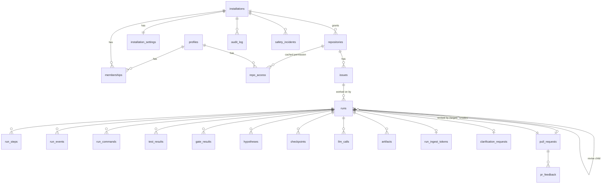

# Fixie — Backend Schema (v2.0)

Oct 31, 2026 · @Mahajan Sarthak Dileep · Team MisfitMinds · Supabase org **Whiteroom** → project **Fixie** · Supersedes "Backend Schema — PatchPilot" · Companion to TRD v2.0

Supabase Postgres schema for Fixie Hub: 25 tables in four groups (identity and tenancy, runs and evidence, pull requests, operations), every tenant row keyed to a GitHub App installation, row-level security on every table, and SQL functions for ingest projection, metrics, gates, incidents, rate limits and retention. The two migration files in `supabase/migrations/` are the source of truth and are reproduced in §16; both were applied and smoke-tested on PostgreSQL 16 with Supabase stubs (§14). The Hub is optional: the Fixie Action and CLI work without any of this.

## 1. Conventions and tenancy model

- **Tenant** = a GitHub App installation (one org or user account). Every tenant-owned row carries `installation_id`, and child tables reference parents with composite foreign keys `(id, installation_id)`, so no row can point into another tenant.
- **Schema** `public` (D-17), RLS enabled on every table. Extensions: `pgcrypto`, `citext`; platform migration also uses `pg_cron`, `pg_net`, Vault, Realtime and Storage.
- **Keys:** `uuid` for entities (`gen_random_uuid()`; the engine may supply UUIDv7 run ids); `bigint generated always as identity` for append-heavy logs (`run_events`, `run_commands`, `test_results`, `llm_calls`, `audit_log`). GitHub ids are `bigint` (`github_*_id`), unique, never our PK. Logins and repo names are `citext`.
- **Time** `timestamptz` (UTC). Mutable tables have `created_at`/`updated_at` (trigger-maintained). **Money** `numeric`, never float.
- **Closed sets** are Postgres enums; adding a value is an additive migration. **Deletes** of tenant data cascade from `installations`; day-to-day removal is a timestamp (`removed_at`, `uninstalled_at`, `deleted_at`).
- **Code is not stored in tables** except short, secret-scanned excerpts that the UI needs (diagnosis, suspicious-region snippets, failure messages, commands); these are nulled after `retention_days`. Full logs, patches and traces live in Storage.
- **Access pattern.** The browser uses the publishable key with the user's session and can only `SELECT`, filtered by RLS. All writes go through server routes using the secret key (service role) after explicit authorisation helpers, and are audited. Ingest writes go through one function, `ingest_events()`.
- **Naming.** `snake_case`, plural tables, FK columns `<singular>_id`, indexes `ix_<table>_<cols>`, uniques `ux_…`.

## 2. Entity relationships



`webhook_deliveries` and `rate_limits` are platform tables with no tenant FK.

## 3. Identity and tenancy

GitHub is the source of truth for people and access; these tables mirror it.

### `profiles`

| Column | Type | Null | Default | Notes |
| --- | --- | --- | --- | --- |
| `id` | uuid | no |  | = `auth.users.id`; created by the `on_auth_user_created` trigger |
| `github_user_id` | bigint | no |  | Stable GitHub id (`raw_user_meta_data.provider_id`) |
| `login` | citext | no |  | Mutable; refreshed at sign-in |
| `name` | text | yes |  |  |
| `avatar_url` | text | yes |  |  |
| `email` | citext | yes |  |  |
| `is_staff` | boolean | no | `false` | Read-only support access, audited |
| `last_sign_in_at` | timestamptz | yes |  |  |
| `deleted_at` | timestamptz | yes |  | Set on account deletion; row anonymised |
| `created_at` | timestamptz | no | `now()` |  |
| `updated_at` | timestamptz | no | `now()` |  |

- **PK** `(id)`
- **Unique** `(github_user_id)`
- **FK** `(id) REFERENCES auth.users(id) ON DELETE CASCADE`

### `installations`

| Column | Type | Null | Default | Notes |
| --- | --- | --- | --- | --- |
| `id` | uuid | no | `gen_random_uuid()` |  |
| `github_installation_id` | bigint | no |  |  |
| `account_github_id` | bigint | no |  |  |
| `account_login` | citext | no |  | URL key `/o/{org}`; unique among active installations |
| `account_type` | github_account_type | no |  |  |
| `repository_selection` | repo_selection | no |  |  |
| `granted_permissions` | jsonb | no | `'{}'` |  |
| `suspended_at` | timestamptz | yes |  |  |
| `paused_at` | timestamptz | yes |  | Set by safety incidents or staff; blocks new runs |
| `pause_reason` | text | yes |  |  |
| `uninstalled_at` | timestamptz | yes |  | Starts the 30-day purge clock |
| `created_at` | timestamptz | no | `now()` |  |
| `updated_at` | timestamptz | no | `now()` |  |

- **PK** `(id)`
- **Unique** `(github_installation_id)`
- **Checks** (2): `CHECK (((paused_at IS NULL) = (pause_reason IS NULL)))`; `CHECK ((char_length(pause_reason) <= 500))`

### `memberships`

| Column | Type | Null | Default | Notes |
| --- | --- | --- | --- | --- |
| `user_id` | uuid | no |  |  |
| `installation_id` | uuid | no |  |  |
| `role` | membership_role | no |  | `admin` = org admin or account owner (D-24) |
| `synced_at` | timestamptz | no | `now()` |  |
| `created_at` | timestamptz | no | `now()` |  |

- **PK** `(user_id, installation_id)`
- **FK** `(installation_id) REFERENCES installations(id) ON DELETE CASCADE`
- **FK** `(user_id) REFERENCES profiles(id) ON DELETE CASCADE`

### `repositories`

| Column | Type | Null | Default | Notes |
| --- | --- | --- | --- | --- |
| `id` | uuid | no | `gen_random_uuid()` |  |
| `installation_id` | uuid | no |  |  |
| `github_repo_id` | bigint | no |  |  |
| `full_name` | citext | no |  |  |
| `name` | citext | no |  | Repo name without owner; URL key `/repos/{repo}` |
| `default_branch` | text | no |  |  |
| `is_private` | boolean | no |  |  |
| `primary_language` | text | yes |  |  |
| `framework` | test_framework | yes |  | Detected test framework, for the setup page |
| `enabled` | boolean | no | `false` | On in this Hub (dispatch + live view); CHECK requires setup (D-26) |
| `enabled_by` | uuid | yes |  |  |
| `enabled_at` | timestamptz | yes |  |  |
| `disabled_reason` | text | yes |  |  |
| `workflow_status` | workflow_status | no | `'unknown'::workflow_status` |  |
| `workflow_detail` | jsonb | no | `'{}'` | `{actionRef, model, hubUrl, permissionsMissing[], triggersMissing[]}` |
| `actions_can_create_prs` | boolean | yes |  | From the repo workflow-permissions setting |
| `protection_status` | protection_status | no | `'unknown'::protection_status` |  |
| `protection_detail` | jsonb | no | `'{}'` | `{rulesetNames[], approvals, lastPushApproval, bypassActors[]}` |
| `config_status` | config_status | no | `'unknown'::config_status` |  |
| `config_sha` | text | yes |  |  |
| `config_errors` | jsonb | no | `'[]'` | `[{path, message}]` from Zod validation of `.fixie.yml` |
| `effective_config` | jsonb | no | `'{}'` | `[{key, value, source}]` for the setup page table |
| `setup_checked_at` | timestamptz | yes |  |  |
| `last_doctor` | jsonb | yes |  | `{at, workflowRunUrl, results[{id, status, message}]}` |
| `removed_at` | timestamptz | yes |  |  |
| `created_at` | timestamptz | no | `now()` |  |
| `updated_at` | timestamptz | no | `now()` |  |

- **PK** `(id)`
- **Unique** `(github_repo_id)`
- **Unique** `(id, installation_id)`
- **FK** `(installation_id) REFERENCES installations(id) ON DELETE CASCADE`
- **FK** `(enabled_by) REFERENCES profiles(id) ON DELETE SET NULL`
- **Checks** (2): `CHECK ((char_length(disabled_reason) <= 500))`; `CHECK (((NOT enabled) OR ((protection_status = 'ok'::protection_status) AND (workflow_status = 'present'::w…`

### `repo_access`

| Column | Type | Null | Default | Notes |
| --- | --- | --- | --- | --- |
| `user_id` | uuid | no |  |  |
| `repository_id` | uuid | no |  |  |
| `installation_id` | uuid | no |  |  |
| `permission` | github_permission | no |  |  |
| `checked_at` | timestamptz | no | `now()` |  |
| `expires_at` | timestamptz | no | `(now() + '00:10:00'::interval)` | checked_at + 10 min; refreshed before repo-scoped writes |

- **PK** `(user_id, repository_id)`
- **FK** `(user_id) REFERENCES profiles(id) ON DELETE CASCADE`
- **FK** `(repository_id, installation_id) REFERENCES repositories(id, installation_id) ON DELETE CASCADE`

## 4. Settings

Engine settings live in each repo's `.fixie.yml` (D-12); the Hub stores only installation-level Hub settings and a cached, validated copy of each repo's effective config on `repositories`.

### `installation_settings`

| Column | Type | Null | Default | Notes |
| --- | --- | --- | --- | --- |
| `installation_id` | uuid | no |  |  |
| `allow_dashboard_runs` | boolean | no | `true` |  |
| `monthly_spend_cap_usd` | numeric(10,2) | yes |  | NULL = no cap; free presets cost 0 |
| `spend_alert_pct` | smallint | no | `80` |  |
| `retention_days` | smallint | no | `30` |  |
| `require_ruleset` | boolean | no | `true` | Locked true in v1 |
| `updated_by` | uuid | yes |  |  |
| `updated_at` | timestamptz | no | `now()` |  |
| `version` | integer | no | `1` | Optimistic concurrency; bumped by trigger |

- **PK** `(installation_id)`
- **FK** `(updated_by) REFERENCES profiles(id) ON DELETE SET NULL`
- **FK** `(installation_id) REFERENCES installations(id) ON DELETE CASCADE`
- **Checks** (4): `CHECK (((monthly_spend_cap_usd IS NULL) OR ((monthly_spend_cap_usd >= (1)::numeric) AND (monthly_spend_cap_…`; `CHECK (((spend_alert_pct >= 1) AND (spend_alert_pct <= 100)))`; `CHECK ((retention_days = ANY (ARRAY[7, 14, 30, 60, 90])))`; `CHECK (require_ruleset)`

## 5. Runs and evidence

A run is one attempt to turn an issue into a PR (or a report). Everything it did and proved hangs off `runs.id`. All evidence rows are written only by `ingest_events()`.

### `issues`

| Column | Type | Null | Default | Notes |
| --- | --- | --- | --- | --- |
| `id` | uuid | no | `gen_random_uuid()` |  |
| `installation_id` | uuid | no |  |  |
| `repository_id` | uuid | no |  |  |
| `github_issue_id` | bigint | no |  |  |
| `number` | integer | no |  |  |
| `title` | text | no |  |  |
| `reporter_login` | citext | yes |  |  |
| `state` | issue_state | no | `'open'::issue_state` |  |
| `created_at` | timestamptz | no | `now()` |  |
| `updated_at` | timestamptz | no | `now()` |  |

- **PK** `(id)`
- **Unique** `(github_issue_id)`
- **Unique** `(repository_id, number)`
- **Unique** `(id, installation_id)`
- **FK** `(repository_id, installation_id) REFERENCES repositories(id, installation_id) ON DELETE CASCADE`
- **Checks** (1): `CHECK ((char_length(title) <= 512))`

### `runs`

| Column | Type | Null | Default | Notes |
| --- | --- | --- | --- | --- |
| `id` | uuid | no | `gen_random_uuid()` | Generated by the Hub (dispatch) or the engine (UUIDv7) and passed on ingest |
| `installation_id` | uuid | no |  |  |
| `repository_id` | uuid | no |  |  |
| `issue_id` | uuid | no |  |  |
| `parent_run_id` | uuid | yes |  |  |
| `target_pull_request_id` | uuid | yes |  |  |
| `trigger` | run_trigger | no |  |  |
| `mode` | run_mode | no | `'action'::run_mode` |  |
| `triggered_by_login` | citext | no |  |  |
| `triggered_by_user_id` | uuid | yes |  |  |
| `status` | run_status | no | `'queued'::run_status` | See `00_START_HERE.md` §4 |
| `outcome` | run_outcome | yes |  | Set exactly when status is terminal |
| `failure_detail` | text | yes |  |  |
| `tier` | run_tier | yes |  |  |
| `github_run_id` | bigint | yes |  |  |
| `github_run_attempt` | integer | yes |  |  |
| `github_run_url` | text | yes |  |  |
| `github_run_history` | jsonb | no | `'[]'` | Every workflow run that worked on this run (resume, re-attempt) |
| `head_sha` | text | yes |  |  |
| `fixie_version` | text | yes |  |  |
| `model_preset` | text | yes |  |  |
| `model_name` | text | yes |  |  |
| `bug_spec` | jsonb | yes |  | Issue-derived JSON (D-22); not code |
| `diagnosis` | text | yes |  | May quote code; nulled after `retention_days` |
| `bisect` | jsonb | yes |  | `{status, goodSha, firstBadSha, steps, skipped, commit, range}` |
| `suspicious` | jsonb | no | `'[]'` | Top regions; `snippet` keys stripped after `retention_days` |
| `blast_radius` | jsonb | yes |  |  |
| `sandbox` | jsonb | yes |  | `{image, cpus, memoryMb, networkLockedAt, egressProbe}` |
| `proof_card` | jsonb | yes |  | `ProofCard` JSON (TRD §3.7) |
| `confidence_score` | smallint | yes |  |  |
| `confidence_level` | confidence_level | yes |  |  |
| `effective_config` | jsonb | no | `'{}'` | Resolved `.fixie.yml`, frozen at start |
| `revise_feedback` | text | yes |  |  |
| `repro_attempts` | smallint | no | `0` |  |
| `fix_attempts` | smallint | no | `0` |  |
| `rollbacks` | smallint | no | `0` |  |
| `hypotheses_count` | smallint | no | `0` |  |
| `llm_calls_count` | integer | no | `0` |  |
| `llm_cost_usd` | numeric(12,6) | no | `0` |  |
| `compute_seconds` | integer | no | `0` |  |
| `last_event_seq` | integer | no | `0` | Highest ingested event `seq` |
| `last_event_at` | timestamptz | yes |  |  |
| `cancel_requested_at` | timestamptz | yes |  |  |
| `cancel_requested_by` | uuid | yes |  |  |
| `trace_object_key` | text | yes |  |  |
| `evidence_purged_at` | timestamptz | yes |  | When code-bearing fields were nulled |
| `queued_at` | timestamptz | no | `now()` |  |
| `started_at` | timestamptz | yes |  |  |
| `finished_at` | timestamptz | yes |  |  |
| `created_at` | timestamptz | no | `now()` |  |
| `updated_at` | timestamptz | no | `now()` |  |

- **PK** `(id)`
- **Unique** `(id, installation_id)`
- **FK** `(target_pull_request_id, installation_id) REFERENCES pull_requests(id, installation_id) ON DELETE SET NULL (target_pull_request_id)`
- **FK** `(issue_id, installation_id) REFERENCES issues(id, installation_id) ON DELETE CASCADE`
- **FK** `(repository_id, installation_id) REFERENCES repositories(id, installation_id) ON DELETE CASCADE`
- **FK** `(cancel_requested_by) REFERENCES profiles(id) ON DELETE SET NULL`
- **FK** `(triggered_by_user_id) REFERENCES profiles(id) ON DELETE SET NULL`
- **FK** `(parent_run_id) REFERENCES runs(id) ON DELETE SET NULL`
- **Checks** (9): `CHECK (((finished_at IS NULL) OR (started_at IS NULL) OR (finished_at >= started_at)))`; `CHECK (((status <> 'cancelled'::run_status) OR (outcome = 'cancelled'::run_outcome)))`; `CHECK (((status <> 'succeeded'::run_status) OR (outcome = ANY (ARRAY['pr_opened'::run_outcome, 'pr_updated'…`; `CHECK (((status = ANY (ARRAY['succeeded'::run_status, 'failed'::run_status, 'cancelled'::run_status])) = (o…`; `CHECK ((char_length(revise_feedback) <= 4000))`; `CHECK (((confidence_score >= 0) AND (confidence_score <= 100)))`; `CHECK ((head_sha ~ '^[0-9a-f]{40}$'::text))`; `CHECK ((char_length(failure_detail) <= 2000))`; `CHECK (((trigger = 'revise'::run_trigger) = (parent_run_id IS NOT NULL)))`

### `run_steps`

| Column | Type | Null | Default | Notes |
| --- | --- | --- | --- | --- |
| `id` | uuid | no | `gen_random_uuid()` |  |
| `run_id` | uuid | no |  |  |
| `installation_id` | uuid | no |  |  |
| `step` | run_step | no |  |  |
| `attempt` | smallint | no | `1` |  |
| `status` | step_status | no |  |  |
| `summary` | text | yes |  |  |
| `started_at` | timestamptz | no | `now()` |  |
| `finished_at` | timestamptz | yes |  |  |

- **PK** `(id)`
- **Unique** `(run_id, step, attempt)`
- **FK** `(run_id, installation_id) REFERENCES runs(id, installation_id) ON DELETE CASCADE`
- **Checks** (2): `CHECK ((attempt >= 1))`; `CHECK ((char_length(summary) <= 2000))`

### `run_events`

| Column | Type | Null | Default | Notes |
| --- | --- | --- | --- | --- |
| `id` | bigint | no |  |  |
| `run_id` | uuid | no |  |  |
| `installation_id` | uuid | no |  |  |
| `seq` | integer | no |  | Engine sequence; UNIQUE (run_id, seq) makes ingest idempotent |
| `type` | text | no |  | Event type, e.g. `step.started` (§9) |
| `step` | run_step | yes |  |  |
| `level` | event_level | no | `'info'::event_level` |  |
| `message` | text | yes |  |  |
| `data` | jsonb | yes |  |  |
| `created_at` | timestamptz | no | `now()` | Engine timestamp (`ts`) |
| `received_at` | timestamptz | no | `now()` |  |

- **PK** `(id)`
- **Unique** `(run_id, seq)`
- **FK** `(run_id, installation_id) REFERENCES runs(id, installation_id) ON DELETE CASCADE`
- **Checks** (3): `CHECK ((type ~ '^[a-z_]+\.[a-z_]+$'::text))`; `CHECK ((char_length(message) <= 2000))`; `CHECK ((seq >= 1))`

### `run_commands`

| Column | Type | Null | Default | Notes |
| --- | --- | --- | --- | --- |
| `id` | bigint | no |  |  |
| `run_id` | uuid | no |  |  |
| `installation_id` | uuid | no |  |  |
| `seq` | integer | no |  |  |
| `step` | run_step | no |  |  |
| `command` | text | yes |  | ≤ 4,000 chars, secret-scanned; nulled after retention |
| `cwd` | text | no | `'/work'` |  |
| `exit_code` | integer | yes |  |  |
| `timed_out` | boolean | no | `false` |  |
| `output_bytes` | bigint | no | `0` |  |
| `log_object_key` | text | yes |  | `run-logs/{installationId}/{runId}/commands/{seq}.log.gz` |
| `redaction_count` | integer | no | `0` |  |
| `started_at` | timestamptz | no | `now()` |  |
| `duration_ms` | integer | yes |  |  |

- **PK** `(id)`
- **Unique** `(run_id, seq)`
- **FK** `(run_id, installation_id) REFERENCES runs(id, installation_id) ON DELETE CASCADE`
- **Checks** (2): `CHECK ((char_length(command) <= 4000))`; `CHECK ((seq >= 1))`

### `test_results`

| Column | Type | Null | Default | Notes |
| --- | --- | --- | --- | --- |
| `id` | bigint | no |  |  |
| `run_id` | uuid | no |  |  |
| `installation_id` | uuid | no |  |  |
| `phase` | test_phase | no |  |  |
| `framework` | test_framework | no |  |  |
| `test_id` | text | no |  |  |
| `is_repro` | boolean | no | `false` | The Fixie-written repro test |
| `outcome` | test_outcome | no |  |  |
| `duration_ms` | integer | yes |  |  |
| `failure_message` | text | yes |  |  |

- **PK** `(id)`
- **Unique** `(run_id, phase, test_id)`
- **FK** `(run_id, installation_id) REFERENCES runs(id, installation_id) ON DELETE CASCADE`
- **Checks** (2): `CHECK ((char_length(test_id) <= 1000))`; `CHECK ((char_length(failure_message) <= 4000))`

### `gate_results`

| Column | Type | Null | Default | Notes |
| --- | --- | --- | --- | --- |
| `id` | uuid | no | `gen_random_uuid()` |  |
| `run_id` | uuid | no |  |  |
| `installation_id` | uuid | no |  |  |
| `gate` | gate_kind | no |  |  |
| `attempt` | smallint | no |  | Repro attempt for repro gates, fix attempt for the rest |
| `passed` | boolean | no |  |  |
| `evidence` | jsonb | no | `'{}'` |  |
| `evaluated_at` | timestamptz | no | `now()` |  |

- **PK** `(id)`
- **Unique** `(run_id, gate, attempt)`
- **FK** `(run_id, installation_id) REFERENCES runs(id, installation_id) ON DELETE CASCADE`
- **Checks** (1): `CHECK ((attempt >= 1))`

### `hypotheses`

| Column | Type | Null | Default | Notes |
| --- | --- | --- | --- | --- |
| `id` | uuid | no | `gen_random_uuid()` |  |
| `run_id` | uuid | no |  |  |
| `installation_id` | uuid | no |  |  |
| `ordinal` | smallint | no |  |  |
| `summary` | text | no |  |  |
| `rationale` | text | yes |  |  |
| `files` | text[] | no | `'{}'` |  |
| `status` | hypothesis_status | no | `'proposed'::hypothesis_status` |  |
| `rejection_reason` | text | yes |  |  |
| `created_at` | timestamptz | no | `now()` |  |
| `updated_at` | timestamptz | no | `now()` |  |

- **PK** `(id)`
- **Unique** `(run_id, ordinal)`
- **FK** `(run_id, installation_id) REFERENCES runs(id, installation_id) ON DELETE CASCADE`
- **Checks** (4): `CHECK ((char_length(summary) <= 500))`; `CHECK ((char_length(rejection_reason) <= 500))`; `CHECK ((char_length(rationale) <= 2000))`; `CHECK ((ordinal >= 1))`

### `checkpoints`

| Column | Type | Null | Default | Notes |
| --- | --- | --- | --- | --- |
| `id` | uuid | no | `gen_random_uuid()` |  |
| `run_id` | uuid | no |  |  |
| `installation_id` | uuid | no |  |  |
| `seq` | smallint | no |  |  |
| `kind` | checkpoint_kind | no |  |  |
| `hypothesis_ordinal` | smallint | yes |  |  |
| `attempt` | smallint | yes |  |  |
| `result` | checkpoint_result | no | `'pending'::checkpoint_result` |  |
| `failing_tests` | integer | no | `0` |  |
| `new_failures` | integer | no | `0` |  |
| `error_count` | integer | no | `0` |  |
| `error_signature` | text | yes |  | sha1 prefix of the normalised failure (TRD §3.5) |
| `files_changed` | integer | no | `0` |  |
| `lines_added` | integer | no | `0` |  |
| `lines_removed` | integer | no | `0` |  |
| `reason` | text | yes |  |  |
| `created_at` | timestamptz | no | `now()` |  |

- **PK** `(id)`
- **Unique** `(run_id, seq)`
- **FK** `(run_id, installation_id) REFERENCES runs(id, installation_id) ON DELETE CASCADE`
- **Checks** (3): `CHECK ((char_length(error_signature) <= 64))`; `CHECK ((char_length(reason) <= 500))`; `CHECK ((seq >= 0))`

### `llm_calls`

| Column | Type | Null | Default | Notes |
| --- | --- | --- | --- | --- |
| `id` | bigint | no |  |  |
| `run_id` | uuid | no |  |  |
| `installation_id` | uuid | no |  |  |
| `purpose` | llm_purpose | no |  |  |
| `step` | run_step | no |  |  |
| `preset` | text | no |  |  |
| `model` | text | no |  |  |
| `input_tokens` | integer | no | `0` |  |
| `output_tokens` | integer | no | `0` |  |
| `cost_usd` | numeric(12,6) | no | `0` | 0 for free presets; prompts are never stored in the DB |
| `latency_ms` | integer | yes |  |  |
| `ok` | boolean | no | `true` |  |
| `error` | text | yes |  |  |
| `created_at` | timestamptz | no | `now()` |  |

- **PK** `(id)`
- **FK** `(run_id, installation_id) REFERENCES runs(id, installation_id) ON DELETE CASCADE`
- **Checks** (4): `CHECK ((input_tokens >= 0))`; `CHECK ((output_tokens >= 0))`; `CHECK ((cost_usd >= (0)::numeric))`; `CHECK ((char_length(error) <= 500))`

### `artifacts`

| Column | Type | Null | Default | Notes |
| --- | --- | --- | --- | --- |
| `id` | uuid | no | `gen_random_uuid()` |  |
| `run_id` | uuid | no |  |  |
| `installation_id` | uuid | no |  |  |
| `kind` | artifact_kind | no |  |  |
| `bucket` | text | no |  | `run-logs` or `run-artifacts` |
| `object_key` | text | no |  |  |
| `sha256` | bytea | yes |  |  |
| `size_bytes` | bigint | no | `0` |  |
| `content_type` | text | no |  |  |
| `expires_at` | timestamptz | no | `(now() + '30 days'::interval)` |  |
| `deleted_at` | timestamptz | yes |  |  |
| `created_at` | timestamptz | no | `now()` |  |

- **PK** `(id)`
- **Unique** `(object_key)`
- **FK** `(run_id, installation_id) REFERENCES runs(id, installation_id) ON DELETE CASCADE`
- **Checks** (3): `CHECK ((bucket = ANY (ARRAY['run-logs'::text, 'run-artifacts'::text])))`; `CHECK (((sha256 IS NULL) OR (octet_length(sha256) = 32)))`; `CHECK ((size_bytes >= 0))`

### `run_ingest_tokens`

| Column | Type | Null | Default | Notes |
| --- | --- | --- | --- | --- |
| `run_id` | uuid | no |  |  |
| `token_hash` | bytea | no |  | SHA-256 of the 32-byte run token; server-only |
| `expires_at` | timestamptz | no |  |  |
| `created_at` | timestamptz | no | `now()` |  |

- **PK** `(run_id)`
- **FK** `(run_id) REFERENCES runs(id) ON DELETE CASCADE`
- **Checks** (1): `CHECK ((octet_length(token_hash) = 32))`

## 6. Pull requests, feedback and clarifications

`pull_requests` is fed by ingest (`pr.opened`) and GitHub webhooks (state changes).

### `pull_requests`

| Column | Type | Null | Default | Notes |
| --- | --- | --- | --- | --- |
| `id` | uuid | no | `gen_random_uuid()` |  |
| `installation_id` | uuid | no |  |  |
| `repository_id` | uuid | no |  |  |
| `issue_id` | uuid | no |  |  |
| `created_by_run_id` | uuid | no |  |  |
| `github_pr_id` | bigint | no |  |  |
| `number` | integer | no |  |  |
| `html_url` | text | no |  |  |
| `head_branch` | text | no |  | CHECK `LIKE 'fixie/%'` |
| `head_sha` | text | no |  |  |
| `state` | pr_state | no | `'draft'::pr_state` |  |
| `revision_count` | smallint | no | `0` |  |
| `ungated` | boolean | no | `false` | Set by trigger if gates were not all passed (D-18) |
| `ready_at` | timestamptz | yes |  |  |
| `first_review_at` | timestamptz | yes |  |  |
| `merged_at` | timestamptz | yes |  |  |
| `merged_by_login` | citext | yes |  | A bot/app value raises `app_merge` |
| `closed_at` | timestamptz | yes |  |  |
| `reverted_at` | timestamptz | yes |  |  |
| `created_at` | timestamptz | no | `now()` |  |
| `updated_at` | timestamptz | no | `now()` |  |

- **PK** `(id)`
- **Unique** `(repository_id, number)`
- **Unique** `(created_by_run_id)`
- **Unique** `(id, installation_id)`
- **Unique** `(github_pr_id)`
- **FK** `(repository_id, installation_id) REFERENCES repositories(id, installation_id) ON DELETE CASCADE`
- **FK** `(issue_id, installation_id) REFERENCES issues(id, installation_id) ON DELETE CASCADE`
- **FK** `(created_by_run_id, installation_id) REFERENCES runs(id, installation_id) ON DELETE RESTRICT`
- **Checks** (3): `CHECK (((state = 'merged'::pr_state) = (merged_at IS NOT NULL)))`; `CHECK ((head_sha ~ '^[0-9a-f]{40}$'::text))`; `CHECK ((head_branch ~~ 'fixie/%'::text))`

### `pr_feedback`

| Column | Type | Null | Default | Notes |
| --- | --- | --- | --- | --- |
| `pull_request_id` | uuid | no |  |  |
| `user_id` | uuid | no |  |  |
| `installation_id` | uuid | no |  |  |
| `rating` | smallint | no |  | -1 or 1 |
| `comment` | text | yes |  |  |
| `created_at` | timestamptz | no | `now()` |  |
| `updated_at` | timestamptz | no | `now()` |  |

- **PK** `(pull_request_id, user_id)`
- **FK** `(user_id) REFERENCES profiles(id) ON DELETE CASCADE`
- **FK** `(pull_request_id, installation_id) REFERENCES pull_requests(id, installation_id) ON DELETE CASCADE`
- **Checks** (2): `CHECK ((char_length(comment) <= 1000))`; `CHECK ((rating = ANY (ARRAY['-1'::integer, 1])))`

### `clarification_requests`

| Column | Type | Null | Default | Notes |
| --- | --- | --- | --- | --- |
| `id` | uuid | no | `gen_random_uuid()` |  |
| `run_id` | uuid | no |  |  |
| `installation_id` | uuid | no |  |  |
| `github_comment_id` | bigint | no |  |  |
| `missing_fields` | text[] | no |  |  |
| `asked_at` | timestamptz | no | `now()` |  |
| `expires_at` | timestamptz | no | `(now() + '7 days'::interval)` | asked_at + 7 days |
| `answered_at` | timestamptz | yes |  |  |
| `answer_comment_id` | bigint | yes |  |  |

- **PK** `(id)`
- **Unique** `(run_id)`
- **FK** `(run_id, installation_id) REFERENCES runs(id, installation_id) ON DELETE CASCADE`
- **Checks** (1): `CHECK ((cardinality(missing_fields) > 0))`

## 7. Operations

Platform tables written only by server code.

### `webhook_deliveries`

| Column | Type | Null | Default | Notes |
| --- | --- | --- | --- | --- |
| `delivery_id` | uuid | no |  | `X-GitHub-Delivery`; dedupe key |
| `event` | text | no |  |  |
| `action` | text | yes |  |  |
| `github_installation_id` | bigint | yes |  |  |
| `signature_valid` | boolean | no |  |  |
| `received_at` | timestamptz | no | `now()` |  |
| `processed_at` | timestamptz | yes |  |  |
| `error` | text | yes |  |  |

- **PK** `(delivery_id)`
- **Checks** (1): `CHECK ((char_length(error) <= 2000))`

### `audit_log`

| Column | Type | Null | Default | Notes |
| --- | --- | --- | --- | --- |
| `id` | bigint | no |  |  |
| `installation_id` | uuid | yes |  |  |
| `actor_type` | actor_type | no |  |  |
| `actor_user_id` | uuid | yes |  |  |
| `actor_label` | text | no |  |  |
| `action` | text | no |  | Dotted verb, e.g. `repo.enabled` |
| `target_type` | text | no |  |  |
| `target_id` | text | no |  |  |
| `metadata` | jsonb | no | `'{}'` | Before/after for settings |
| `ip` | inet | yes |  |  |
| `created_at` | timestamptz | no | `now()` |  |

- **PK** `(id)`
- **FK** `(actor_user_id) REFERENCES profiles(id) ON DELETE SET NULL`
- **FK** `(installation_id) REFERENCES installations(id) ON DELETE SET NULL`
- **Checks** (1): `CHECK ((action ~ '^[a-z_]+\.[a-z_]+$'::text))`

### `safety_incidents`

| Column | Type | Null | Default | Notes |
| --- | --- | --- | --- | --- |
| `id` | uuid | no | `gen_random_uuid()` |  |
| `kind` | incident_kind | no |  |  |
| `installation_id` | uuid | yes |  |  |
| `repository_id` | uuid | yes |  |  |
| `run_id` | uuid | yes |  |  |
| `details` | jsonb | no | `'{}'` |  |
| `detected_at` | timestamptz | no | `now()` |  |
| `resolved_at` | timestamptz | yes |  |  |
| `notes` | text | yes |  |  |

- **PK** `(id)`
- **FK** `(run_id) REFERENCES runs(id) ON DELETE SET NULL`
- **FK** `(installation_id) REFERENCES installations(id) ON DELETE SET NULL`
- **FK** `(repository_id) REFERENCES repositories(id) ON DELETE SET NULL`

### `rate_limits`

| Column | Type | Null | Default | Notes |
| --- | --- | --- | --- | --- |
| `key` | text | no |  |  |
| `window_start` | timestamptz | no |  |  |
| `count` | integer | no |  |  |

- **PK** `(key)`

## 8. Indexes

Every index serves a named query; unique constraints already create their own indexes.

| Index | Columns | Serves |
| --- | --- | --- |
| `ux_installations_login_active` | installations (account_login) WHERE uninstalled_at IS NULL | Resolve `/o/{org}` |
| `ux_repositories_installation_name` | repositories (installation_id, name) WHERE removed_at IS NULL | Resolve `/repos/{repo}` |
| `ix_memberships_installation` | memberships (installation_id, role) | Members list, admin checks |
| `ix_repositories_installation` | repositories (installation_id) WHERE removed_at IS NULL | Repos page |
| `ix_repositories_full_name` | repositories (full_name) | Webhook and OIDC lookups |
| `ix_repo_access_repo`, `ix_repo_access_installation`, `ix_repo_access_expiry` | repo_access | Cascades, refresh of stale rows |
| `ux_runs_active_per_issue` | runs (issue_id) WHERE status not terminal | One active run per issue (partial unique) |
| `ix_runs_installation_created` | runs (installation_id, created_at DESC, id DESC) INCLUDE (status, outcome, llm_cost_usd) | Runs list keyset, Overview, spend |
| `ix_runs_repo_created` | runs (repository_id, created_at DESC, id DESC) | Repo page runs |
| `ix_runs_active` | runs (status, last_event_at) WHERE not terminal | Stale-run cron, live counts |
| `ix_runs_issue`, `ix_runs_parent`, `ix_runs_github_run` | runs | Issue history, revise chains, webhook reconcile |
| `ix_run_steps_run`, `ix_run_events_run`, `ix_run_commands_run` | (run_id, …) | Tracker, timeline and polling `after=`, logs tab |
| `ix_run_events_received` | run_events (received_at) | 90-day purge |
| `ix_test_results_phase`, `ix_gate_results_run`, `ix_hypotheses_run`, `ix_checkpoints_run`, `ix_llm_calls_run`, `ix_artifacts_run` | (run_id, …) | Run detail tabs, `failing_gates()` |
| `ix_artifacts_expiry` | artifacts (expires_at) WHERE deleted_at IS NULL | Storage retention cron |
| `ix_prs_repo_state`, `ix_prs_installation_merged`, `ix_prs_issue` | pull_requests | Merge rate, north-star metric, "PR already open" gate |
| `ix_clarifications_open` | clarification_requests (expires_at) WHERE answered_at IS NULL | Expiry display |
| `ix_webhooks_received` | webhook_deliveries (received_at) | 14-day purge |
| `ix_audit_installation_created`, `ix_audit_target` | audit_log | Audit page keyset, history of one target |
| `ix_incidents_open` | safety_incidents (installation_id) WHERE resolved_at IS NULL | Pause banner |

**Pagination** is keyset everywhere (`created_at DESC, id DESC` with an opaque base64 cursor of both values), never `OFFSET`.

## 9. Event contract (ingest → projection)

`POST /api/ingest/v1/runs/:id/events` calls `ingest_events(run_id, events)` with the service role. Each event is `{seq, ts, type, step?, level?, message?, data}`; it is stored in `run_events` (idempotent on `(run_id, seq)`) and projected as below in the same transaction. Types are defined once in `packages/shared/events.ts`.

| `type` | `data` fields | Projection |
| --- | --- | --- |
| `run.status` | `status, outcome?, failureDetail?, tier?, headSha?, sandbox?, model{preset,name}?, fixieVersion?` | `runs` status/outcome/details; sets `started_at` when leaving queued/awaiting, `finished_at` when terminal |
| `step.started` / `step.finished` | `step, attempt, status?, summary?` | Upsert `run_steps`; `reproduce`/`fix` attempts update `runs.repro_attempts` / `fix_attempts` |
| `bug_spec.ready` | `spec` | `runs.bug_spec` |
| `clarification.requested` / `clarification.answered` | `commentId, missingFields[], askedAt, expiresAt` / `commentId, answeredAt` | Upsert `clarification_requests` |
| `command.started` / `command.finished` | `commandSeq, step, command, cwd` / `commandSeq, exitCode, timedOut, durationMs, outputBytes, redactionCount, logKey?` | Upsert `run_commands` |
| `tests.reported` | `phase, framework, results[{testId, outcome, durationMs?, failureMessage?, isRepro?}]` | Upsert `test_results` |
| `gate.evaluated` | `gate, attempt, passed, evidence` | Upsert `gate_results` |
| `llm.call` | `purpose, step, preset, model, inputTokens, outputTokens, costUsd, latencyMs, ok, error?` | Insert `llm_calls`; increment `runs.llm_calls_count`, `llm_cost_usd` |
| `bisect.finished` | `status, goodSha?, firstBadSha?, steps, skipped, commit?, range?` | `runs.bisect` |
| `localize.finished` | `suspicious[{path, startLine, endLine, score, sources[], snippet}]` | `runs.suspicious` |
| `blast_radius.ready` (P1) | `callers, files, impactedTests, impactedPassed, list[]` | `runs.blast_radius` |
| `hypothesis.updated` | `ordinal, summary, rationale?, files[]?, status, rejectionReason?` | Upsert `hypotheses`; `runs.hypotheses_count` |
| `checkpoint.created` | `seq, kind, hypothesisOrdinal?, attempt?, result, failingTests, newFailures, errorCount, errorSignature?, filesChanged, linesAdded, linesRemoved, reason?` | Upsert `checkpoints`; `rolled_back` increments `runs.rollbacks` |
| `diagnosis.ready` | `markdown` | `runs.diagnosis` |
| `proof_card.ready` | `proofCard, confidence{score, level}` | `runs.proof_card`, confidence columns |
| `pr.opened` | `githubPrId, number, url, headBranch, headSha` | Insert `pull_requests` (trigger flags ungated PRs) |
| `pr.updated` | `number, headSha, revision` | `record_pr_push()` (flags ungated pushes) |
| `incident.raised` | `kind, details` | `raise_incident()` → incident + pause + audit |
| `log.line`, `comment.posted` | free-form | Stored only |

Unknown types are stored and ignored, so older Hubs accept newer engines.

## 10. Authentication and session handling

- **Users** sign in with Supabase Auth's GitHub provider (D-13, TRD §10.3). `auth.users` is owned by Supabase; the `on_auth_user_created` trigger creates `profiles` from `raw_user_meta_data` (`provider_id`, `user_name`, `full_name`, `avatar_url`). The OAuth callback then upserts `memberships` and `repo_access` with the secret key using the one-time `provider_token`, which is never stored.
- **Sessions** are Supabase Auth sessions in `@supabase/ssr` cookies (HttpOnly, Secure, SameSite=Lax), refreshed by `src/proxy.ts`. `list_my_sessions()` and `revoke_my_session(id)` expose only the caller's rows from `auth.sessions` (P1). Revoked devices keep a valid access token until it expires (≤ 1 hour).
- **CSRF**: mutations are same-origin only (`Origin` check) and SameSite cookies; there are no cookie-authenticated cross-site writes.
- **Repo freshness**: `repo_access.expires_at` (10 minutes). The server refreshes stale rows with an installation token before repo-scoped writes; revocation deletes rows, which RLS reflects immediately.
- **Machine callers.**

| Caller | Authenticates with | Stored |
| --- | --- | --- |
| Browser | Supabase session (publishable key) | Supabase-managed |
| Hub server routes | Secret key (service role), server-only module | Env var |
| GitHub webhooks | HMAC SHA-256 with `GITHUB_WEBHOOK_SECRET` | `webhook_deliveries` row only |
| Fixie engine (ingest) | GitHub Actions OIDC → run token | `run_ingest_tokens.token_hash` (SHA-256), 6 h |
| pg_cron → Hub cron routes | `Authorization: Bearer CRON_SECRET` (Vault) | Vault |
| Hub → GitHub | App JWT → installation tokens | Memory only |

## 11. Permissions

**Application rules** (enforced in route handlers; RLS mirrors the read side).

| Action | Member, repo read | Member, repo write | Admin | Staff |
| --- | --- | --- | --- | --- |
| View repos, setup, runs, evidence, logs, metrics | Yes | Yes | Yes | Yes, audited |
| Start, re-run, run doctor, cancel | No | Yes | Yes (with repo write) | Cancel only, audited |
| Turn repo on/off in the Hub | No | No | Yes | No |
| Installation settings | No | No | Yes | No |
| Audit log, safety incidents | No | No | Yes | Yes |
| Rate a PR explanation | Yes | Yes | Yes | No |
| Resolve incidents, unpause | No | No | No | Yes |

**Database roles.**

| Role | Used by | Privileges |
| --- | --- | --- |
| `anon` | Signed-out browser | Nothing in `public` |
| `authenticated` | Signed-in browser and server components with the user session | `SELECT` on tenant tables through RLS; `EXECUTE` on access helpers, `installation_metrics`, own-session functions |
| `service_role` | Server routes, ingest, webhooks, cron (secret key) | All tables (bypasses RLS); `EXECUTE` on `ingest_events`, `raise_incident`, `record_pr_push`, `hit_rate_limit`, `purge_expired_data` |
| `postgres` | Migrations, `SECURITY DEFINER` function owner | Owner |

**RLS policies** (all `FOR SELECT TO authenticated`; there are no write policies).

| Table(s) | Policy |
| --- | --- |
| `profiles` | `shares_installation(id)` (self or someone in a shared installation) |
| `installations`, `memberships`, `installation_settings` | `is_member(installation_id)` |
| `repositories`, `issues`, `runs`, `pull_requests` | `can_read_repo(repository_id)` (or `id` for repositories) |
| `run_steps`, `run_events`, `run_commands`, `test_results`, `gate_results`, `hypotheses`, `checkpoints`, `llm_calls`, `artifacts`, `clarification_requests` | `can_read_run(run_id)` |
| `repo_access` | `user_id = auth.uid()` |
| `pr_feedback` | The PR is visible |
| `audit_log`, `safety_incidents` | `is_admin(installation_id)` |
| `webhook_deliveries`, `rate_limits`, `run_ingest_tokens` | None (service role only) |

**Functions.**

| Function | Mode | Purpose |
| --- | --- | --- |
| `is_member`, `is_admin`, `shares_installation`, `can_read_repo`, `can_write_repo`, `can_read_run` | `SECURITY DEFINER`, `search_path=''` | RLS helpers without recursion |
| `failing_gates(run_id)` | invoker | Gates whose latest attempt didn't pass |
| `flag_ungated_pr()` (trigger), `record_pr_push()` | definer | Record and flag ungated PRs/pushes (D-18) |
| `raise_incident()` | definer | Incident + pause + audit |
| `ingest_events()` | definer, service role | Store and project events |
| `installation_metrics()` | invoker (RLS applies) | Overview KPIs and series |
| `hit_rate_limit()` | definer | Fixed-window limiter |
| `purge_expired_data()` | definer | Retention (§12) |
| `handle_new_user()` (trigger on `auth.users`) | definer | Create profiles |
| `list_my_sessions()`, `revoke_my_session()` | definer | Own sessions |
| `call_hub_cron()` | definer | pg_net call to Hub cron routes |

RLS is **enabled, not forced**: `SECURITY DEFINER` functions owned by `postgres` must bypass it to project ingest data.

## 12. Data ownership, retention and deletion

| Owner | Tables | Who changes it |
| --- | --- | --- |
| Installation (tenant) | installations, installation_settings, repositories, repo_access, memberships, issues, runs and all evidence, pull_requests, clarification_requests, tenant audit rows, incidents | Admins (Hub settings); Fixie engine via ingest (run data); GitHub sync (mirrored fields) |
| User | profiles, own sessions, own pr_feedback | The user; staff for revocation |
| Platform | webhook_deliveries, rate_limits, run_ingest_tokens | Hub server only |
| GitHub (mirrored) | logins, repo names, default branch, issue title/state, PR state, permissions | Overwritten by sync and webhooks |
| The repository itself | `.fixie.yml`, `.fixie/*`, workflow, trace artifacts on GitHub | Repo maintainers |

| Data | Kept | Then |
| --- | --- | --- |
| Sandbox filesystem | Life of the job | Container and runner VM destroyed |
| Storage logs, patches, traces | `retention_days` (default 30) | `/api/cron/retention` deletes objects, sets `artifacts.deleted_at` |
| `runs.diagnosis`, suspicious snippets, `run_commands.command`, `test_results.failure_message`, `log.line` messages | `retention_days` after the run finishes | Nulled by `purge_expired_data()`; `runs.evidence_purged_at` set |
| `run_events`, `run_commands` rows | 90 days | Deleted |
| `runs` and their evidence, `pull_requests`, `llm_calls` | 13 months | Deleted (PRs first) |
| `webhook_deliveries` | 14 days | Deleted |
| `audit_log` | 1 year (UI note) | Export before deleting is P2 |
| `safety_incidents` | Indefinitely | Kept |
| Uninstalled installations | 30 days | Hard delete with cascade |

**Uninstall** (`installation.deleted`): set `uninstalled_at`, disable repos, delete `repo_access`. Re-installing within 30 days clears `uninstalled_at`. **Repo removed** from the installation: set `removed_at`, `enabled = false`. **Account deletion** (P1): delete Supabase auth user (cascades `profiles`, memberships, repo_access, feedback); audit rows keep `actor_label`.

## 13. Storage layout

| Bucket | Key | Written by | Read by |
| --- | --- | --- | --- |
| `run-logs` | `{installationId}/{runId}/commands/{seq}.log.gz` | Engine via signed upload URL from `/uploads` | Logs tab via 15-minute signed URL after an RLS-checked query |
| `run-artifacts` | `{installationId}/{runId}/patch.diff`, `…/junit/{phase}.xml`, `…/proof-card.json`, `…/report.md`, `…/trace.zip` (opt-in) | Same | Diff tab, replay, downloads |

Each uploaded object gets an `artifacts` row (kind, bucket, size, sha256, `expires_at = now() + retention_days`). Buckets are private and have no Storage RLS policies for `authenticated`; only server-issued signed URLs reach the browser.

## 14. Migrations and verification

| File | Contents |
| --- | --- |
| `supabase/migrations/20261101000100_core.sql` | Enums, 25 tables, indexes, triggers, helper and safety functions, `ingest_events`, `installation_metrics`, rate limiting, retention, RLS, grants |
| `supabase/migrations/20261101000200_platform.sql` | `auth.users` trigger, own-session functions, Realtime publication, Storage buckets, `pg_cron` jobs via `pg_net` and Vault |
| `supabase/tests/00_plain_postgres_stubs.sql` | Minimal `auth`, `storage`, `cron`, `net`, `vault` stubs and Supabase roles, to test on plain PostgreSQL 16 |
| `supabase/tests/01_schema_smoke.sql` | Behaviour tests: setup-gated enable, one active run per issue, idempotent ingest projection, ungated PR → incident → pause, append-only audit, rate limiting, RLS member vs outsider, browser can't write, sessions, purge |

**Verified** (Oct 31, 2026) on PostgreSQL 16: both migrations apply cleanly and every smoke test passes. On Supabase: enable `pg_cron` and `pg_net`, create the two Vault secrets, run `supabase db push`, then `supabase gen types typescript --linked > packages/shared/src/db.types.ts`. In CI, run the smoke file against `supabase start` (local stack) after migrations.

## 15. Seed data plan (`supabase/seed.sql`, dev only)

One installation `Agent-X-Hackathon-2026-Team-MisfitMinds` (admin + member user), three repos (`fixie-demo-python` Ready and On; `fixie-demo-ts` Ready and Off; `legacy-app` with missing workflow and `weak` ruleset), and about 24 runs created through `ingest_events()` (never by direct inserts into evidence tables) covering: every status, all 13 outcomes, a run with 2 rolled-back attempts and 3 hypotheses, bisect `found`/`dependency_boundary`/`no_good_commit`, low/medium/high confidence, a revise chain, a clarification waiting and one expired, PRs in draft/open/merged/closed, one ungated PR incident (on a separate paused installation). Seed data lets the frontend build every state before the engine exists.

## 16. Full SQL

### `supabase/migrations/20261101000100_core.sql`

```sql
-- Fixie Hub — core schema (types, tables, indexes, functions, triggers, RLS, grants)
-- Target: Supabase Postgres (PG 15+). Schema: public. Apply with `supabase db push`.
-- Platform-specific parts (auth trigger, sessions, realtime, storage, pg_cron) are in 20261101000200_platform.sql.

begin;

create extension if not exists pgcrypto;
create extension if not exists citext;

-- ============================================================
-- Enum types
-- ============================================================
create type public.membership_role     as enum ('admin','member');
create type public.github_account_type as enum ('organization','user');
create type public.repo_selection      as enum ('all','selected');
create type public.github_permission   as enum ('read','triage','write','maintain','admin');
create type public.protection_status   as enum ('unknown','ok','weak','missing','bypass');
create type public.workflow_status     as enum ('unknown','missing','present','outdated','invalid');
create type public.config_status       as enum ('unknown','missing','valid','invalid');
create type public.issue_state         as enum ('open','closed');
create type public.run_trigger         as enum ('label','comment','dashboard','revise','cli');
create type public.run_mode            as enum ('action','cli');
create type public.run_status          as enum ('queued','awaiting_info','awaiting_confirmation','provisioning',
                                                'baseline','reproducing','diagnosing','fixing','verifying',
                                                'opening_pr','succeeded','failed','cancelled');
create type public.run_outcome         as enum ('pr_opened','pr_updated','could_not_reproduce','could_not_fix',
                                                'fix_plan','not_our_code','info_timeout','environment_error',
                                                'gate_violation','blocked_path','budget_exceeded','infra_error',
                                                'cancelled');
create type public.run_step            as enum ('bug_spec','triage','provision','install','baseline','reproduce',
                                                'confirm_intent','bisect','localize','hypothesize','fix','verify',
                                                'stress','explain','open_pr','report','teardown');
create type public.run_tier            as enum ('t0_autofix','t1_fix','t2_plan','t3_report');
create type public.step_status         as enum ('running','passed','failed','skipped');
create type public.event_level         as enum ('debug','info','warn','error');
create type public.test_phase          as enum ('baseline','repro_before','repro_after','final','stress');
create type public.test_framework      as enum ('pytest','jest','vitest');
create type public.test_outcome        as enum ('passed','failed','error','skipped');
create type public.gate_kind           as enum ('repro_fails_before','repro_passes_after','no_new_failures',
                                                'lint_clean','typecheck_clean','diff_size','blocked_paths',
                                                'test_integrity','secret_scan');
create type public.hypothesis_status   as enum ('proposed','trying','accepted','rejected','abandoned','skipped');
create type public.checkpoint_kind     as enum ('baseline','repro','attempt','revert');
create type public.checkpoint_result   as enum ('pending','passed','rolled_back','no_progress','patch_failed','gate_failed');
create type public.confidence_level    as enum ('high','medium','low');
create type public.llm_purpose         as enum ('bug_spec','repro_test','hypotheses','patch','explain');
create type public.artifact_kind       as enum ('patch','junit_xml','command_log','trace','proof_card','report');
create type public.pr_state            as enum ('draft','open','closed','merged');
create type public.actor_type          as enum ('user','github_user','engine','system','staff');
create type public.incident_kind       as enum ('secret_exposure','unapproved_egress','unexpected_push',
                                                'app_merge','ungated_pr','sandbox_escape');

-- ============================================================
-- Helpers
-- ============================================================
create function public.touch_updated_at() returns trigger
language plpgsql as $$
begin
  new.updated_at := now();
  return new;
end $$;

-- ============================================================
-- Identity and tenancy
-- ============================================================
create table public.profiles (
  id               uuid primary key references auth.users(id) on delete cascade,
  github_user_id   bigint not null unique,
  login            citext not null,
  name             text,
  avatar_url       text,
  email            citext,
  is_staff         boolean not null default false,
  last_sign_in_at  timestamptz,
  deleted_at       timestamptz,
  created_at       timestamptz not null default now(),
  updated_at       timestamptz not null default now()
);

create table public.installations (
  id                      uuid primary key default gen_random_uuid(),
  github_installation_id  bigint not null unique,
  account_github_id       bigint not null,
  account_login           citext not null,
  account_type            public.github_account_type not null,
  repository_selection    public.repo_selection not null,
  granted_permissions     jsonb not null default '{}',
  suspended_at            timestamptz,
  paused_at               timestamptz,
  pause_reason            text check (char_length(pause_reason) <= 500),
  uninstalled_at          timestamptz,
  created_at              timestamptz not null default now(),
  updated_at              timestamptz not null default now(),
  check ((paused_at is null) = (pause_reason is null))
);

create table public.memberships (
  user_id          uuid not null references public.profiles(id) on delete cascade,
  installation_id  uuid not null references public.installations(id) on delete cascade,
  role             public.membership_role not null,
  synced_at        timestamptz not null default now(),
  created_at       timestamptz not null default now(),
  primary key (user_id, installation_id)
);

create table public.repositories (
  id                      uuid primary key default gen_random_uuid(),
  installation_id         uuid not null references public.installations(id) on delete cascade,
  github_repo_id          bigint not null unique,
  full_name               citext not null,
  name                    citext not null,
  default_branch          text not null,
  is_private              boolean not null,
  primary_language        text,
  framework               public.test_framework,
  enabled                 boolean not null default false,
  enabled_by              uuid references public.profiles(id) on delete set null,
  enabled_at              timestamptz,
  disabled_reason         text check (char_length(disabled_reason) <= 500),
  workflow_status         public.workflow_status not null default 'unknown',
  workflow_detail         jsonb not null default '{}',   -- {actionRef, model, hubUrl, permissionsMissing[], triggersMissing[]}
  actions_can_create_prs  boolean,
  protection_status       public.protection_status not null default 'unknown',
  protection_detail       jsonb not null default '{}',   -- {rulesetNames[], approvals, lastPushApproval, bypassActors[]}
  config_status           public.config_status not null default 'unknown',
  config_sha              text,
  config_errors           jsonb not null default '[]',   -- [{path, message}]
  effective_config        jsonb not null default '{}',   -- [{key, value, source}]
  setup_checked_at        timestamptz,
  last_doctor             jsonb,                          -- {at, workflowRunUrl, results[{id, status, message}]}
  removed_at              timestamptz,
  created_at              timestamptz not null default now(),
  updated_at              timestamptz not null default now(),
  unique (id, installation_id),
  check (not enabled or (protection_status = 'ok'
                         and workflow_status = 'present'
                         and coalesce(actions_can_create_prs, false)
                         and config_status <> 'invalid'
                         and removed_at is null))
);
create unique index ux_repositories_installation_name on public.repositories (installation_id, name)
  where removed_at is null;

create table public.repo_access (
  user_id          uuid not null references public.profiles(id) on delete cascade,
  repository_id    uuid not null,
  installation_id  uuid not null,
  permission       public.github_permission not null,
  checked_at       timestamptz not null default now(),
  expires_at       timestamptz not null default now() + interval '10 minutes',
  primary key (user_id, repository_id),
  foreign key (repository_id, installation_id)
    references public.repositories(id, installation_id) on delete cascade
);

create table public.installation_settings (
  installation_id        uuid primary key references public.installations(id) on delete cascade,
  allow_dashboard_runs   boolean not null default true,
  monthly_spend_cap_usd  numeric(10,2) check (monthly_spend_cap_usd is null or monthly_spend_cap_usd between 1 and 10000),
  spend_alert_pct        smallint not null default 80 check (spend_alert_pct between 1 and 100),
  retention_days         smallint not null default 30 check (retention_days in (7,14,30,60,90)),
  require_ruleset        boolean not null default true check (require_ruleset),
  updated_by             uuid references public.profiles(id) on delete set null,
  updated_at             timestamptz not null default now(),
  version                integer not null default 1
);

-- ============================================================
-- Runs and evidence
-- ============================================================
create table public.issues (
  id               uuid primary key default gen_random_uuid(),
  installation_id  uuid not null,
  repository_id    uuid not null,
  github_issue_id  bigint not null unique,
  number           integer not null,
  title            text not null check (char_length(title) <= 512),
  reporter_login   citext,
  state            public.issue_state not null default 'open',
  created_at       timestamptz not null default now(),
  updated_at       timestamptz not null default now(),
  unique (repository_id, number),
  unique (id, installation_id),
  foreign key (repository_id, installation_id)
    references public.repositories(id, installation_id) on delete cascade
);

create table public.runs (
  id                      uuid primary key default gen_random_uuid(),
  installation_id         uuid not null,
  repository_id           uuid not null,
  issue_id                uuid not null,
  parent_run_id           uuid references public.runs(id) on delete set null,
  target_pull_request_id  uuid,                          -- FK added after pull_requests
  trigger                 public.run_trigger not null,
  mode                    public.run_mode not null default 'action',
  triggered_by_login      citext not null,
  triggered_by_user_id    uuid references public.profiles(id) on delete set null,
  status                  public.run_status not null default 'queued',
  outcome                 public.run_outcome,
  failure_detail          text check (char_length(failure_detail) <= 2000),
  tier                    public.run_tier,
  github_run_id           bigint,
  github_run_attempt      integer,
  github_run_url          text,
  github_run_history      jsonb not null default '[]',   -- [{githubRunId, attempt, url, startedAt}]
  head_sha                text check (head_sha ~ '^[0-9a-f]{40}$'),
  fixie_version           text,
  model_preset            text,
  model_name              text,
  bug_spec                jsonb,
  diagnosis               text,                          -- nulled after retention_days
  bisect                  jsonb,                         -- {status, goodSha, firstBadSha, steps, skipped, commit{}, range}
  suspicious              jsonb not null default '[]',   -- [{path, startLine, endLine, score, sources[], snippet}]
  blast_radius            jsonb,
  sandbox                 jsonb,                         -- {image, cpus, memoryMb, networkLockedAt, egressProbe}
  proof_card              jsonb,
  confidence_score        smallint check (confidence_score between 0 and 100),
  confidence_level        public.confidence_level,
  effective_config        jsonb not null default '{}',
  revise_feedback         text check (char_length(revise_feedback) <= 4000),
  repro_attempts          smallint not null default 0,
  fix_attempts            smallint not null default 0,
  rollbacks               smallint not null default 0,
  hypotheses_count        smallint not null default 0,
  llm_calls_count         integer not null default 0,
  llm_cost_usd            numeric(12,6) not null default 0,
  compute_seconds         integer not null default 0,
  last_event_seq          integer not null default 0,
  last_event_at           timestamptz,
  cancel_requested_at     timestamptz,
  cancel_requested_by     uuid references public.profiles(id) on delete set null,
  trace_object_key        text,
  evidence_purged_at      timestamptz,
  queued_at               timestamptz not null default now(),
  started_at              timestamptz,
  finished_at             timestamptz,
  created_at              timestamptz not null default now(),
  updated_at              timestamptz not null default now(),
  unique (id, installation_id),
  foreign key (repository_id, installation_id)
    references public.repositories(id, installation_id) on delete cascade,
  foreign key (issue_id, installation_id)
    references public.issues(id, installation_id) on delete cascade,
  check ((status in ('succeeded','failed','cancelled')) = (outcome is not null)),
  check (status <> 'succeeded' or outcome in ('pr_opened','pr_updated')),
  check (status <> 'cancelled' or outcome = 'cancelled'),
  check (finished_at is null or started_at is null or finished_at >= started_at),
  check ((trigger = 'revise') = (parent_run_id is not null))
);

create table public.run_steps (
  id               uuid primary key default gen_random_uuid(),
  run_id           uuid not null,
  installation_id  uuid not null,
  step             public.run_step not null,
  attempt          smallint not null default 1 check (attempt >= 1),
  status           public.step_status not null,
  summary          text check (char_length(summary) <= 2000),
  started_at       timestamptz not null default now(),
  finished_at      timestamptz,
  unique (run_id, step, attempt),
  foreign key (run_id, installation_id) references public.runs(id, installation_id) on delete cascade
);

create table public.run_events (
  id               bigint generated always as identity primary key,
  run_id           uuid not null,
  installation_id  uuid not null,
  seq              integer not null check (seq >= 1),
  type             text not null check (type ~ '^[a-z_]+\.[a-z_]+$'),
  step             public.run_step,
  level            public.event_level not null default 'info',
  message          text check (char_length(message) <= 2000),   -- nulled after retention_days for logs
  data             jsonb,
  created_at       timestamptz not null default now(),          -- engine timestamp
  received_at      timestamptz not null default now(),
  unique (run_id, seq),
  foreign key (run_id, installation_id) references public.runs(id, installation_id) on delete cascade
);

create table public.run_commands (
  id               bigint generated always as identity primary key,
  run_id           uuid not null,
  installation_id  uuid not null,
  seq              integer not null check (seq >= 1),
  step             public.run_step not null,
  command          text check (char_length(command) <= 4000),   -- nulled after retention_days
  cwd              text not null default '/work',
  exit_code        integer,
  timed_out        boolean not null default false,
  output_bytes     bigint not null default 0,
  log_object_key   text,
  redaction_count  integer not null default 0,
  started_at       timestamptz not null default now(),
  duration_ms      integer,
  unique (run_id, seq),
  foreign key (run_id, installation_id) references public.runs(id, installation_id) on delete cascade
);

create table public.test_results (
  id               bigint generated always as identity primary key,
  run_id           uuid not null,
  installation_id  uuid not null,
  phase            public.test_phase not null,
  framework        public.test_framework not null,
  test_id          text not null check (char_length(test_id) <= 1000),
  is_repro         boolean not null default false,
  outcome          public.test_outcome not null,
  duration_ms      integer,
  failure_message  text check (char_length(failure_message) <= 4000),  -- nulled after retention_days
  unique (run_id, phase, test_id),
  foreign key (run_id, installation_id) references public.runs(id, installation_id) on delete cascade
);

create table public.gate_results (
  id               uuid primary key default gen_random_uuid(),
  run_id           uuid not null,
  installation_id  uuid not null,
  gate             public.gate_kind not null,
  attempt          smallint not null check (attempt >= 1),
  passed           boolean not null,
  evidence         jsonb not null default '{}',
  evaluated_at     timestamptz not null default now(),
  unique (run_id, gate, attempt),
  foreign key (run_id, installation_id) references public.runs(id, installation_id) on delete cascade
);

create table public.hypotheses (
  id                uuid primary key default gen_random_uuid(),
  run_id            uuid not null,
  installation_id   uuid not null,
  ordinal           smallint not null check (ordinal >= 1),
  summary           text not null check (char_length(summary) <= 500),
  rationale         text check (char_length(rationale) <= 2000),
  files             text[] not null default '{}',
  status            public.hypothesis_status not null default 'proposed',
  rejection_reason  text check (char_length(rejection_reason) <= 500),
  created_at        timestamptz not null default now(),
  updated_at        timestamptz not null default now(),
  unique (run_id, ordinal),
  foreign key (run_id, installation_id) references public.runs(id, installation_id) on delete cascade
);

create table public.checkpoints (
  id                  uuid primary key default gen_random_uuid(),
  run_id              uuid not null,
  installation_id     uuid not null,
  seq                 smallint not null check (seq >= 0),
  kind                public.checkpoint_kind not null,
  hypothesis_ordinal  smallint,
  attempt             smallint,
  result              public.checkpoint_result not null default 'pending',
  failing_tests       integer not null default 0,
  new_failures        integer not null default 0,
  error_count         integer not null default 0,
  error_signature     text check (char_length(error_signature) <= 64),
  files_changed       integer not null default 0,
  lines_added         integer not null default 0,
  lines_removed       integer not null default 0,
  reason              text check (char_length(reason) <= 500),
  created_at          timestamptz not null default now(),
  unique (run_id, seq),
  foreign key (run_id, installation_id) references public.runs(id, installation_id) on delete cascade
);

create table public.llm_calls (
  id               bigint generated always as identity primary key,
  run_id           uuid not null,
  installation_id  uuid not null,
  purpose          public.llm_purpose not null,
  step             public.run_step not null,
  preset           text not null,
  model            text not null,
  input_tokens     integer not null default 0 check (input_tokens >= 0),
  output_tokens    integer not null default 0 check (output_tokens >= 0),
  cost_usd         numeric(12,6) not null default 0 check (cost_usd >= 0),
  latency_ms       integer,
  ok               boolean not null default true,
  error            text check (char_length(error) <= 500),
  created_at       timestamptz not null default now(),
  foreign key (run_id, installation_id) references public.runs(id, installation_id) on delete cascade
);

create table public.artifacts (
  id               uuid primary key default gen_random_uuid(),
  run_id           uuid not null,
  installation_id  uuid not null,
  kind             public.artifact_kind not null,
  bucket           text not null check (bucket in ('run-logs','run-artifacts')),
  object_key       text not null unique,
  sha256           bytea check (sha256 is null or octet_length(sha256) = 32),
  size_bytes       bigint not null default 0 check (size_bytes >= 0),
  content_type     text not null,
  expires_at       timestamptz not null default now() + interval '30 days',
  deleted_at       timestamptz,
  created_at       timestamptz not null default now(),
  foreign key (run_id, installation_id) references public.runs(id, installation_id) on delete cascade
);

-- Run-scoped ingest tokens (server-only; never granted to authenticated)
create table public.run_ingest_tokens (
  run_id      uuid primary key references public.runs(id) on delete cascade,
  token_hash  bytea not null check (octet_length(token_hash) = 32),
  expires_at  timestamptz not null,
  created_at  timestamptz not null default now()
);

-- ============================================================
-- Pull requests, feedback, clarifications
-- ============================================================
create table public.pull_requests (
  id                 uuid primary key default gen_random_uuid(),
  installation_id    uuid not null,
  repository_id      uuid not null,
  issue_id           uuid not null,
  created_by_run_id  uuid not null unique,
  github_pr_id       bigint not null unique,
  number             integer not null,
  html_url           text not null,
  head_branch        text not null check (head_branch like 'fixie/%'),
  head_sha           text not null check (head_sha ~ '^[0-9a-f]{40}$'),
  state              public.pr_state not null default 'draft',
  revision_count     smallint not null default 0,
  ungated            boolean not null default false,
  ready_at           timestamptz,
  first_review_at    timestamptz,
  merged_at          timestamptz,
  merged_by_login    citext,
  closed_at          timestamptz,
  reverted_at        timestamptz,
  created_at         timestamptz not null default now(),
  updated_at         timestamptz not null default now(),
  unique (repository_id, number),
  unique (id, installation_id),
  foreign key (repository_id, installation_id)
    references public.repositories(id, installation_id) on delete cascade,
  foreign key (issue_id, installation_id)
    references public.issues(id, installation_id) on delete cascade,
  foreign key (created_by_run_id, installation_id)
    references public.runs(id, installation_id) on delete restrict,
  check ((state = 'merged') = (merged_at is not null))
);

alter table public.runs
  add constraint runs_target_pr_fk foreign key (target_pull_request_id, installation_id)
  references public.pull_requests(id, installation_id) on delete set null (target_pull_request_id);

create table public.pr_feedback (
  pull_request_id  uuid not null,
  user_id          uuid not null references public.profiles(id) on delete cascade,
  installation_id  uuid not null,
  rating           smallint not null check (rating in (-1, 1)),
  comment          text check (char_length(comment) <= 1000),
  created_at       timestamptz not null default now(),
  updated_at       timestamptz not null default now(),
  primary key (pull_request_id, user_id),
  foreign key (pull_request_id, installation_id)
    references public.pull_requests(id, installation_id) on delete cascade
);

create table public.clarification_requests (
  id                 uuid primary key default gen_random_uuid(),
  run_id             uuid not null unique,
  installation_id    uuid not null,
  github_comment_id  bigint not null,
  missing_fields     text[] not null check (cardinality(missing_fields) > 0),
  asked_at           timestamptz not null default now(),
  expires_at         timestamptz not null default now() + interval '7 days',
  answered_at        timestamptz,
  answer_comment_id  bigint,
  foreign key (run_id, installation_id) references public.runs(id, installation_id) on delete cascade
);

-- ============================================================
-- Operations
-- ============================================================
create table public.webhook_deliveries (
  delivery_id             uuid primary key,             -- X-GitHub-Delivery
  event                   text not null,
  action                  text,
  github_installation_id  bigint,
  signature_valid         boolean not null,
  received_at             timestamptz not null default now(),
  processed_at            timestamptz,
  error                   text check (char_length(error) <= 2000)
);

create table public.audit_log (
  id               bigint generated always as identity primary key,
  installation_id  uuid references public.installations(id) on delete set null,
  actor_type       public.actor_type not null,
  actor_user_id    uuid references public.profiles(id) on delete set null,
  actor_label      text not null,
  action           text not null check (action ~ '^[a-z_]+\.[a-z_]+$'),
  target_type      text not null,
  target_id        text not null,
  metadata         jsonb not null default '{}',
  ip               inet,
  created_at       timestamptz not null default now()
);

create table public.safety_incidents (
  id               uuid primary key default gen_random_uuid(),
  kind             public.incident_kind not null,
  installation_id  uuid references public.installations(id) on delete set null,
  repository_id    uuid references public.repositories(id) on delete set null,
  run_id           uuid references public.runs(id) on delete set null,
  details          jsonb not null default '{}',
  detected_at      timestamptz not null default now(),
  resolved_at      timestamptz,
  notes            text
);

create table public.rate_limits (
  key           text primary key,
  window_start  timestamptz not null,
  count         integer not null
);

-- ============================================================
-- Indexes (each serves a named query; see schema doc §7)
-- ============================================================
create unique index ux_installations_login_active on public.installations (account_login) where uninstalled_at is null;
create index ix_memberships_installation    on public.memberships (installation_id, role);
create index ix_repositories_installation   on public.repositories (installation_id) where removed_at is null;
create index ix_repositories_full_name      on public.repositories (full_name);
create index ix_repo_access_repo            on public.repo_access (repository_id);
create index ix_repo_access_installation    on public.repo_access (installation_id);
create index ix_repo_access_expiry          on public.repo_access (user_id, expires_at);
create unique index ux_runs_active_per_issue on public.runs (issue_id)
  where status not in ('succeeded','failed','cancelled');
create index ix_runs_installation_created   on public.runs (installation_id, created_at desc, id desc)
  include (status, outcome, llm_cost_usd);
create index ix_runs_repo_created           on public.runs (repository_id, created_at desc, id desc);
create index ix_runs_active                 on public.runs (status, last_event_at)
  where status not in ('succeeded','failed','cancelled');
create index ix_runs_issue                  on public.runs (issue_id, created_at desc);
create index ix_runs_parent                 on public.runs (parent_run_id) where parent_run_id is not null;
create index ix_runs_github_run             on public.runs (github_run_id) where github_run_id is not null;
create index ix_run_steps_run               on public.run_steps (run_id, started_at);
create index ix_run_events_run              on public.run_events (run_id, id);
create index ix_run_events_received         on public.run_events (received_at);
create index ix_run_commands_run            on public.run_commands (run_id, seq);
create index ix_test_results_phase          on public.test_results (run_id, phase, outcome);
create index ix_gate_results_run            on public.gate_results (run_id, gate, attempt desc);
create index ix_hypotheses_run              on public.hypotheses (run_id, ordinal);
create index ix_checkpoints_run             on public.checkpoints (run_id, seq);
create index ix_llm_calls_run               on public.llm_calls (run_id);
create index ix_artifacts_run               on public.artifacts (run_id, kind);
create index ix_artifacts_expiry            on public.artifacts (expires_at) where deleted_at is null;
create index ix_prs_repo_state              on public.pull_requests (repository_id, state, created_at desc);
create index ix_prs_installation_merged     on public.pull_requests (installation_id, merged_at) where merged_at is not null;
create index ix_prs_issue                   on public.pull_requests (issue_id) where state in ('draft','open');
create index ix_clarifications_open         on public.clarification_requests (expires_at) where answered_at is null;
create index ix_webhooks_received           on public.webhook_deliveries (received_at);
create index ix_audit_installation_created  on public.audit_log (installation_id, created_at desc, id desc);
create index ix_audit_target                on public.audit_log (target_type, target_id);
create index ix_incidents_open              on public.safety_incidents (installation_id) where resolved_at is null;

-- ============================================================
-- updated_at triggers
-- ============================================================
do $$
declare t text;
begin
  foreach t in array array['profiles','installations','repositories','issues','runs',
                           'hypotheses','pull_requests','pr_feedback']
  loop
    execute format('create trigger trg_%1$s_touch before update on public.%1$I
                    for each row execute function public.touch_updated_at()', t);
  end loop;
end $$;

create function public.touch_settings() returns trigger
language plpgsql as $$
begin
  new.updated_at := now();
  new.version := old.version + 1;
  return new;
end $$;
create trigger trg_installation_settings_touch before update on public.installation_settings
  for each row execute function public.touch_settings();

-- ============================================================
-- Access helpers (SECURITY DEFINER avoids RLS recursion; search_path pinned)
-- ============================================================
create function public.is_member(p_installation_id uuid) returns boolean
language sql stable security definer set search_path = '' as $$
  select exists (select 1 from public.memberships m
                 where m.user_id = auth.uid() and m.installation_id = p_installation_id)
$$;

create function public.is_admin(p_installation_id uuid) returns boolean
language sql stable security definer set search_path = '' as $$
  select exists (select 1 from public.memberships m
                 where m.user_id = auth.uid() and m.installation_id = p_installation_id
                   and m.role = 'admin')
$$;

create function public.shares_installation(p_profile_id uuid) returns boolean
language sql stable security definer set search_path = '' as $$
  select p_profile_id = auth.uid() or exists (
    select 1 from public.memberships a
    join public.memberships b on b.installation_id = a.installation_id
    where a.user_id = auth.uid() and b.user_id = p_profile_id)
$$;

create function public.can_read_repo(p_repository_id uuid) returns boolean
language sql stable security definer set search_path = '' as $$
  select exists (
    select 1 from public.repo_access ra
    join public.memberships m on m.user_id = ra.user_id and m.installation_id = ra.installation_id
    where ra.user_id = auth.uid() and ra.repository_id = p_repository_id)
$$;

create function public.can_write_repo(p_repository_id uuid) returns boolean
language sql stable security definer set search_path = '' as $$
  select exists (
    select 1 from public.repo_access ra
    join public.memberships m on m.user_id = ra.user_id and m.installation_id = ra.installation_id
    where ra.user_id = auth.uid() and ra.repository_id = p_repository_id
      and ra.permission in ('write','maintain','admin'))
$$;

create function public.can_read_run(p_run_id uuid) returns boolean
language sql stable security definer set search_path = '' as $$
  select public.can_read_repo((select r.repository_id from public.runs r where r.id = p_run_id))
$$;

-- ============================================================
-- Safety: gates, incidents, PR recording
-- ============================================================
-- Gates whose latest attempt did not pass (or that were never evaluated). Empty array = all passed.
create function public.failing_gates(p_run_id uuid) returns public.gate_kind[]
language sql stable set search_path = '' as $$
  select coalesce(array_agg(g order by g), '{}')
  from unnest(enum_range(null::public.gate_kind)) as g
  where not exists (
    select 1 from public.gate_results gr
    where gr.run_id = p_run_id and gr.gate = g and gr.passed
      and gr.attempt = (select max(x.attempt) from public.gate_results x
                        where x.run_id = p_run_id and x.gate = g))
$$;

create function public.raise_incident(p_kind public.incident_kind, p_installation_id uuid,
                                      p_run_id uuid, p_details jsonb) returns uuid
language plpgsql security definer set search_path = '' as $$
declare v_id uuid;
begin
  insert into public.safety_incidents (kind, installation_id, run_id, repository_id, details)
  values (p_kind, p_installation_id, p_run_id,
          (select r.repository_id from public.runs r where r.id = p_run_id), coalesce(p_details, '{}'))
  returning id into v_id;

  update public.installations
     set paused_at = coalesce(paused_at, now()),
         pause_reason = coalesce(pause_reason, 'Safety incident: ' || p_kind::text)
   where id = p_installation_id;

  insert into public.audit_log (installation_id, actor_type, actor_label, action, target_type, target_id, metadata)
  values (p_installation_id, 'system', 'fixie-hub', 'incident.raised', 'safety_incident', v_id::text,
          jsonb_build_object('kind', p_kind, 'runId', p_run_id));
  return v_id;
end $$;

-- The PR already exists on GitHub when the Hub learns about it, so this trigger records, flags and pauses
-- instead of refusing (D-18). Gate enforcement lives in the engine.
create function public.flag_ungated_pr() returns trigger
language plpgsql security definer set search_path = '' as $$
declare v_missing public.gate_kind[];
begin
  v_missing := public.failing_gates(new.created_by_run_id);
  if cardinality(v_missing) > 0 then
    new.ungated := true;
    perform public.raise_incident('ungated_pr', new.installation_id, new.created_by_run_id,
                                  jsonb_build_object('prNumber', new.number, 'failingGates', to_jsonb(v_missing)));
  end if;
  return new;
end $$;
create trigger trg_pull_requests_gated before insert on public.pull_requests
  for each row execute function public.flag_ungated_pr();

create function public.record_pr_push(p_pull_request_id uuid, p_run_id uuid, p_sha text) returns void
language plpgsql security definer set search_path = '' as $$
declare v_missing public.gate_kind[]; v_installation uuid;
begin
  select installation_id into v_installation from public.pull_requests where id = p_pull_request_id;
  v_missing := public.failing_gates(p_run_id);
  if cardinality(v_missing) > 0 then
    update public.pull_requests set ungated = true where id = p_pull_request_id;
    perform public.raise_incident('ungated_pr', v_installation, p_run_id,
                                  jsonb_build_object('failingGates', to_jsonb(v_missing), 'push', p_sha));
  end if;
  update public.pull_requests
     set head_sha = p_sha, revision_count = revision_count + 1
   where id = p_pull_request_id;
end $$;

-- Audit log is append-only.
create function public.forbid_update_delete() returns trigger
language plpgsql as $$
begin
  raise exception '% is append-only', tg_table_name using errcode = 'insufficient_privilege';
end $$;
create trigger trg_audit_no_update before update or delete on public.audit_log
  for each row execute function public.forbid_update_delete();

-- ============================================================
-- Ingest projection (service role only). Idempotent on (run_id, seq).
-- ============================================================
create function public.ingest_events(p_run_id uuid, p_events jsonb) returns jsonb
language plpgsql security definer set search_path = '' as $$
declare
  v_run       public.runs%rowtype;
  e           jsonb;
  d           jsonb;
  v_seq       integer;
  v_type      text;
  v_ts        timestamptz;
  v_inserted  integer;
  v_accepted  integer := 0;
  v_max_seq   integer := 0;
  v_status    public.run_status;
  v_pr_id     uuid;
begin
  select * into v_run from public.runs where id = p_run_id for update;
  if not found then
    raise exception 'run % not found', p_run_id using errcode = 'no_data_found';
  end if;
  if jsonb_typeof(p_events) <> 'array' or jsonb_array_length(p_events) > 200 then
    raise exception 'events must be an array of at most 200 items' using errcode = 'invalid_parameter_value';
  end if;

  for e in select value from jsonb_array_elements(p_events) order by (value->>'seq')::int
  loop
    v_seq  := (e->>'seq')::int;
    v_type := e->>'type';
    v_ts   := coalesce((e->>'ts')::timestamptz, now());
    d      := coalesce(e->'data', '{}'::jsonb);

    insert into public.run_events (run_id, installation_id, seq, type, step, level, message, data, created_at)
    values (p_run_id, v_run.installation_id, v_seq, v_type,
            (e->>'step')::public.run_step,
            coalesce((e->>'level')::public.event_level, 'info'),
            left(e->>'message', 2000), d, v_ts)
    on conflict (run_id, seq) do nothing;
    get diagnostics v_inserted = row_count;
    v_max_seq := greatest(v_max_seq, v_seq);
    if v_inserted = 0 then
      continue;  -- duplicate delivery: already projected
    end if;
    v_accepted := v_accepted + 1;

    case v_type
    when 'run.status' then
      v_status := (d->>'status')::public.run_status;
      update public.runs set
        status         = v_status,
        outcome        = (d->>'outcome')::public.run_outcome,
        failure_detail = coalesce(left(d->>'failureDetail', 2000), failure_detail),
        tier           = coalesce((d->>'tier')::public.run_tier, tier),
        head_sha       = coalesce(d->>'headSha', head_sha),
        sandbox        = coalesce(d->'sandbox', sandbox),
        model_preset   = coalesce(d#>>'{model,preset}', model_preset),
        model_name     = coalesce(d#>>'{model,name}', model_name),
        fixie_version  = coalesce(d->>'fixieVersion', fixie_version),
        started_at     = case when started_at is null
                                and v_status not in ('queued','awaiting_info') then v_ts else started_at end,
        finished_at    = case when v_status in ('succeeded','failed','cancelled')
                              then coalesce(finished_at, v_ts) else finished_at end
      where id = p_run_id;

    when 'step.started' then
      insert into public.run_steps (run_id, installation_id, step, attempt, status, started_at)
      values (p_run_id, v_run.installation_id, (d->>'step')::public.run_step,
              coalesce((d->>'attempt')::smallint, 1), 'running', v_ts)
      on conflict (run_id, step, attempt) do update set status = 'running', finished_at = null;
      if d->>'step' = 'reproduce' then
        update public.runs set repro_attempts = greatest(repro_attempts, coalesce((d->>'attempt')::smallint, 1))
         where id = p_run_id;
      elsif d->>'step' = 'fix' then
        update public.runs set fix_attempts = greatest(fix_attempts, coalesce((d->>'attempt')::smallint, 1))
         where id = p_run_id;
      end if;

    when 'step.finished' then
      update public.run_steps set
        status = (d->>'status')::public.step_status,
        summary = left(d->>'summary', 2000),
        finished_at = v_ts
      where run_id = p_run_id and step = (d->>'step')::public.run_step
        and attempt = coalesce((d->>'attempt')::smallint, 1);

    when 'bug_spec.ready' then
      update public.runs set bug_spec = d->'spec' where id = p_run_id;

    when 'clarification.requested' then
      insert into public.clarification_requests (run_id, installation_id, github_comment_id, missing_fields,
                                                 asked_at, expires_at)
      values (p_run_id, v_run.installation_id, (d->>'commentId')::bigint,
              array(select jsonb_array_elements_text(d->'missingFields')),
              coalesce((d->>'askedAt')::timestamptz, v_ts),
              coalesce((d->>'expiresAt')::timestamptz, v_ts + interval '7 days'))
      on conflict (run_id) do update set
        github_comment_id = excluded.github_comment_id, missing_fields = excluded.missing_fields,
        asked_at = excluded.asked_at, expires_at = excluded.expires_at, answered_at = null;

    when 'clarification.answered' then
      update public.clarification_requests set
        answered_at = coalesce((d->>'answeredAt')::timestamptz, v_ts),
        answer_comment_id = (d->>'commentId')::bigint
      where run_id = p_run_id;

    when 'command.started' then
      insert into public.run_commands (run_id, installation_id, seq, step, command, cwd, started_at)
      values (p_run_id, v_run.installation_id, (d->>'commandSeq')::int, (d->>'step')::public.run_step,
              left(d->>'command', 4000), coalesce(d->>'cwd', '/work'), v_ts)
      on conflict (run_id, seq) do nothing;

    when 'command.finished' then
      update public.run_commands set
        exit_code = (d->>'exitCode')::int,
        timed_out = coalesce((d->>'timedOut')::boolean, false),
        duration_ms = (d->>'durationMs')::int,
        output_bytes = coalesce((d->>'outputBytes')::bigint, 0),
        redaction_count = coalesce((d->>'redactionCount')::int, 0),
        log_object_key = coalesce(d->>'logKey', log_object_key)
      where run_id = p_run_id and seq = (d->>'commandSeq')::int;

    when 'tests.reported' then
      insert into public.test_results (run_id, installation_id, phase, framework, test_id, is_repro,
                                       outcome, duration_ms, failure_message)
      select p_run_id, v_run.installation_id, (d->>'phase')::public.test_phase,
             (d->>'framework')::public.test_framework, left(t->>'testId', 1000),
             coalesce((t->>'isRepro')::boolean, false), (t->>'outcome')::public.test_outcome,
             (t->>'durationMs')::int, left(t->>'failureMessage', 4000)
      from jsonb_array_elements(coalesce(d->'results', '[]'::jsonb)) as t
      on conflict (run_id, phase, test_id) do update set
        outcome = excluded.outcome, duration_ms = excluded.duration_ms,
        failure_message = excluded.failure_message, is_repro = excluded.is_repro;

    when 'gate.evaluated' then
      insert into public.gate_results (run_id, installation_id, gate, attempt, passed, evidence, evaluated_at)
      values (p_run_id, v_run.installation_id, (d->>'gate')::public.gate_kind,
              coalesce((d->>'attempt')::smallint, 1), (d->>'passed')::boolean,
              coalesce(d->'evidence', '{}'::jsonb), v_ts)
      on conflict (run_id, gate, attempt) do update set
        passed = excluded.passed, evidence = excluded.evidence, evaluated_at = excluded.evaluated_at;

    when 'llm.call' then
      insert into public.llm_calls (run_id, installation_id, purpose, step, preset, model, input_tokens,
                                    output_tokens, cost_usd, latency_ms, ok, error, created_at)
      values (p_run_id, v_run.installation_id, (d->>'purpose')::public.llm_purpose,
              (d->>'step')::public.run_step, d->>'preset', d->>'model',
              coalesce((d->>'inputTokens')::int, 0), coalesce((d->>'outputTokens')::int, 0),
              coalesce((d->>'costUsd')::numeric, 0), (d->>'latencyMs')::int,
              coalesce((d->>'ok')::boolean, true), left(d->>'error', 500), v_ts);
      update public.runs set
        llm_calls_count = llm_calls_count + 1,
        llm_cost_usd = llm_cost_usd + coalesce((d->>'costUsd')::numeric, 0)
      where id = p_run_id;

    when 'bisect.finished' then
      update public.runs set bisect = d where id = p_run_id;

    when 'localize.finished' then
      update public.runs set suspicious = coalesce(d->'suspicious', '[]'::jsonb) where id = p_run_id;

    when 'blast_radius.ready' then
      update public.runs set blast_radius = d where id = p_run_id;

    when 'hypothesis.updated' then
      insert into public.hypotheses as h (run_id, installation_id, ordinal, summary, rationale, files, status,
                                          rejection_reason)
      values (p_run_id, v_run.installation_id, (d->>'ordinal')::smallint, left(d->>'summary', 500),
              left(d->>'rationale', 2000),
              coalesce(array(select jsonb_array_elements_text(d->'files')), '{}'),
              coalesce((d->>'status')::public.hypothesis_status, 'proposed'), left(d->>'rejectionReason', 500))
      on conflict (run_id, ordinal) do update set
        summary = excluded.summary,
        rationale = coalesce(excluded.rationale, h.rationale),
        files = case when cardinality(excluded.files) > 0 then excluded.files else h.files end,
        status = excluded.status,
        rejection_reason = coalesce(excluded.rejection_reason, h.rejection_reason);
      update public.runs set hypotheses_count = greatest(hypotheses_count, (d->>'ordinal')::smallint)
       where id = p_run_id;

    when 'checkpoint.created' then
      insert into public.checkpoints (run_id, installation_id, seq, kind, hypothesis_ordinal, attempt, result,
                                      failing_tests, new_failures, error_count, error_signature,
                                      files_changed, lines_added, lines_removed, reason, created_at)
      values (p_run_id, v_run.installation_id, (d->>'seq')::smallint, (d->>'kind')::public.checkpoint_kind,
              (d->>'hypothesisOrdinal')::smallint, (d->>'attempt')::smallint,
              coalesce((d->>'result')::public.checkpoint_result, 'pending'),
              coalesce((d->>'failingTests')::int, 0), coalesce((d->>'newFailures')::int, 0),
              coalesce((d->>'errorCount')::int, 0), left(d->>'errorSignature', 64),
              coalesce((d->>'filesChanged')::int, 0), coalesce((d->>'linesAdded')::int, 0),
              coalesce((d->>'linesRemoved')::int, 0), left(d->>'reason', 500), v_ts)
      on conflict (run_id, seq) do update set
        result = excluded.result, failing_tests = excluded.failing_tests, new_failures = excluded.new_failures,
        error_count = excluded.error_count, error_signature = excluded.error_signature, reason = excluded.reason;
      if d->>'result' = 'rolled_back' then
        update public.runs set rollbacks = rollbacks + 1 where id = p_run_id;
      end if;

    when 'diagnosis.ready' then
      update public.runs set diagnosis = d->>'markdown' where id = p_run_id;

    when 'proof_card.ready' then
      update public.runs set
        proof_card = d->'proofCard',
        confidence_score = (d#>>'{confidence,score}')::smallint,
        confidence_level = (d#>>'{confidence,level}')::public.confidence_level
      where id = p_run_id;

    when 'pr.opened' then
      insert into public.pull_requests (installation_id, repository_id, issue_id, created_by_run_id, github_pr_id,
                                        number, html_url, head_branch, head_sha, state)
      values (v_run.installation_id, v_run.repository_id, v_run.issue_id, p_run_id, (d->>'githubPrId')::bigint,
              (d->>'number')::int, d->>'url', d->>'headBranch', d->>'headSha', 'draft')
      on conflict (github_pr_id) do nothing;

    when 'pr.updated' then
      select id into v_pr_id from public.pull_requests
       where id = v_run.target_pull_request_id
          or (repository_id = v_run.repository_id and number = (d->>'number')::int)
       limit 1;
      if v_pr_id is not null then
        perform public.record_pr_push(v_pr_id, p_run_id, d->>'headSha');
      end if;

    when 'incident.raised' then
      perform public.raise_incident((d->>'kind')::public.incident_kind, v_run.installation_id, p_run_id,
                                    coalesce(d->'details', '{}'::jsonb));

    else
      null;  -- log, comment.posted and unknown types are stored in run_events only
    end case;
  end loop;

  update public.runs set
    last_event_seq = greatest(last_event_seq, v_max_seq),
    last_event_at  = now()
  where id = p_run_id;

  return jsonb_build_object('accepted', v_accepted, 'lastSeq', greatest(v_run.last_event_seq, v_max_seq));
end $$;

-- ============================================================
-- Metrics (SECURITY INVOKER: RLS applies to the caller)
-- ============================================================
create function public.installation_metrics(p_installation_id uuid, p_from timestamptz, p_to timestamptz,
                                            p_repository_id uuid default null) returns jsonb
language sql stable security invoker set search_path = '' as $$
  with r as (
    select * from public.runs
    where installation_id = p_installation_id
      and (p_repository_id is null or repository_id = p_repository_id)
      and queued_at >= p_from and queued_at < p_to
  ),
  past_setup as (
    select r.id from r where exists (select 1 from public.run_steps s
                                     where s.run_id = r.id and s.step = 'baseline' and s.status = 'passed')
  ),
  reproduced as (
    select r.id, r.model_preset, r.model_name from r
    where exists (select 1 from public.gate_results g
                  where g.run_id = r.id and g.gate = 'repro_fails_before' and g.passed)
  ),
  prs as (
    select p.*, r.queued_at as run_queued_at from public.pull_requests p join r on r.id = p.created_by_run_id
  ),
  merged as (
    select p.* from public.pull_requests p
    where p.installation_id = p_installation_id
      and (p_repository_id is null or p.repository_id = p_repository_id)
      and p.merged_at >= p_from and p.merged_at < p_to
  ),
  bis as (
    select r.id, r.bisect->>'status' as status from r
    where r.bisect is not null and coalesce(r.bisect->>'status', 'not_applicable') <> 'not_applicable'
  )
  select jsonb_build_object(
    'runs',                  (select count(*) from r),
    'pastSetup',             (select count(*) from past_setup),
    'reproduced',            (select count(*) from reproduced),
    'prsOpened',             (select count(*) from prs),
    'prsMergedOfOpened',     (select count(*) from prs where state = 'merged'),
    'merged',                (select count(*) from merged),
    'mergedThisWeek',        (select count(*) from merged where merged_at >= date_trunc('week', now())),
    'medianTimeToPrSeconds', (select percentile_cont(0.5) within group
                                (order by extract(epoch from (created_at - run_queued_at))) from prs),
    'bisected',              (select count(*) from bis),
    'breakingCommitsFound',  (select count(*) from bis where status = 'found'),
    'spendThisMonthUsd',     (select coalesce(sum(x.llm_cost_usd), 0) from public.runs x
                               where x.installation_id = p_installation_id
                                 and x.queued_at >= date_trunc('month', now())),
    'paidModelRuns',         (select count(*) from r where r.llm_cost_usd > 0),
    'weekly', (select coalesce(jsonb_agg(to_jsonb(w) order by w.week), '[]'::jsonb) from (
        select date_trunc('week', queued_at) as week,
               count(*) filter (where outcome in ('pr_opened','pr_updated')) as pr_ready,
               count(*) filter (where outcome in ('could_not_reproduce','could_not_fix','fix_plan',
                                                  'not_our_code','info_timeout','environment_error')) as not_fixed,
               count(*) filter (where outcome in ('gate_violation','blocked_path','budget_exceeded',
                                                  'infra_error')) as failed,
               count(*) filter (where outcome = 'cancelled') as cancelled
        from r group by 1) w),
    'weeklyMedianTimeToPrSeconds', (select coalesce(jsonb_agg(to_jsonb(t) order by t.week), '[]'::jsonb) from (
        select date_trunc('week', run_queued_at) as week,
               percentile_cont(0.5) within group (order by extract(epoch from (created_at - run_queued_at))) as seconds
        from prs group by 1) t),
    'byModel', (select coalesce(jsonb_agg(to_jsonb(m) order by m.runs desc), '[]'::jsonb) from (
        select coalesce(r.model_preset || '/' || r.model_name, 'unknown') as model,
               count(*) as runs,
               count(*) filter (where r.id in (select id from reproduced)) as reproduced,
               count(*) filter (where r.outcome = 'pr_opened') as prs_opened
        from r group by 1) m)
  )
$$;

-- ============================================================
-- Rate limiting (fixed window)
-- ============================================================
create function public.hit_rate_limit(p_key text, p_max integer, p_window_s integer) returns boolean
language plpgsql security definer set search_path = '' as $$
declare v_count integer;
begin
  insert into public.rate_limits as rl (key, window_start, count)
  values (p_key, now(), 1)
  on conflict (key) do update set
    window_start = case when rl.window_start < now() - make_interval(secs => p_window_s)
                        then now() else rl.window_start end,
    count = case when rl.window_start < now() - make_interval(secs => p_window_s)
                 then 1 else rl.count + 1 end
  returning count into v_count;
  return v_count <= p_max;
end $$;

-- ============================================================
-- Retention (called daily by pg_cron; Storage objects are deleted by /api/cron/retention)
-- ============================================================
create function public.purge_expired_data() returns jsonb
language plpgsql security definer set search_path = '' as $$
declare v_runs integer; v_events integer; v_deleted integer;
begin
  -- 1. Null code-bearing fields after each installation's retention_days
  with expired as (
    select r.id from public.runs r
    join public.installation_settings s on s.installation_id = r.installation_id
    where r.evidence_purged_at is null
      and r.finished_at is not null
      and r.finished_at < now() - make_interval(days => s.retention_days)
  ), upd as (
    update public.runs r set
      diagnosis = null,
      suspicious = coalesce((select jsonb_agg(x - 'snippet') from jsonb_array_elements(r.suspicious) x), '[]'::jsonb),
      evidence_purged_at = now()
    from expired where r.id = expired.id
    returning r.id
  )
  select count(*) into v_runs from upd;

  update public.run_commands c set command = null
    from public.runs r where r.id = c.run_id and r.evidence_purged_at is not null and c.command is not null;
  update public.test_results t set failure_message = null
    from public.runs r where r.id = t.run_id and r.evidence_purged_at is not null and t.failure_message is not null;
  update public.run_events e set message = null
    from public.runs r where r.id = e.run_id and r.evidence_purged_at is not null
      and e.type = 'log.line' and e.message is not null;

  -- 2. Fixed windows
  delete from public.run_events where received_at < now() - interval '90 days';
  get diagnostics v_events = row_count;
  delete from public.run_commands where started_at < now() - interval '90 days';
  delete from public.webhook_deliveries where received_at < now() - interval '14 days';
  delete from public.rate_limits where window_start < now() - interval '1 day';

  -- 3. Runs older than 13 months (PRs first: created_by_run_id is ON DELETE RESTRICT)
  delete from public.pull_requests p using public.runs r
   where r.id = p.created_by_run_id and r.queued_at < now() - interval '13 months';
  delete from public.runs where queued_at < now() - interval '13 months';
  get diagnostics v_deleted = row_count;

  -- 4. Uninstalled installations after 30 days (cascades)
  delete from public.installations where uninstalled_at < now() - interval '30 days';

  return jsonb_build_object('runsPurged', v_runs, 'eventsDeleted', v_events, 'oldRunsDeleted', v_deleted);
end $$;

-- ============================================================
-- Row-level security (ENABLE, not FORCE: SECURITY DEFINER functions owned by postgres must bypass)
-- The browser (publishable key, role `authenticated`) can only SELECT. Every write goes through
-- server routes using the secret key after explicit authorisation checks.
-- ============================================================
do $$
declare t text;
begin
  foreach t in array array['profiles','installations','memberships','repositories','repo_access',
                           'installation_settings','issues','runs','run_steps','run_events','run_commands',
                           'test_results','gate_results','hypotheses','checkpoints','llm_calls','artifacts',
                           'pull_requests','pr_feedback','clarification_requests','webhook_deliveries',
                           'audit_log','safety_incidents','rate_limits','run_ingest_tokens']
  loop
    execute format('alter table public.%I enable row level security', t);
  end loop;
end $$;

create policy profiles_read on public.profiles for select to authenticated
  using (public.shares_installation(id));
create policy installations_read on public.installations for select to authenticated
  using (public.is_member(id));
create policy memberships_read on public.memberships for select to authenticated
  using (public.is_member(installation_id));
create policy repositories_read on public.repositories for select to authenticated
  using (public.can_read_repo(id));
create policy repo_access_read on public.repo_access for select to authenticated
  using (user_id = auth.uid());
create policy installation_settings_read on public.installation_settings for select to authenticated
  using (public.is_member(installation_id));
create policy issues_read on public.issues for select to authenticated
  using (public.can_read_repo(repository_id));
create policy runs_read on public.runs for select to authenticated
  using (public.can_read_repo(repository_id));
create policy pull_requests_read on public.pull_requests for select to authenticated
  using (public.can_read_repo(repository_id));
create policy pr_feedback_read on public.pr_feedback for select to authenticated
  using (exists (select 1 from public.pull_requests p where p.id = pull_request_id));
create policy audit_log_read on public.audit_log for select to authenticated
  using (installation_id is not null and public.is_admin(installation_id));
create policy safety_incidents_read on public.safety_incidents for select to authenticated
  using (installation_id is not null and public.is_admin(installation_id));

do $$
declare t text;
begin
  foreach t in array array['run_steps','run_events','run_commands','test_results','gate_results',
                           'hypotheses','checkpoints','llm_calls','artifacts','clarification_requests']
  loop
    execute format('create policy %1$s_read on public.%1$I for select to authenticated
                    using (public.can_read_run(run_id))', t);
  end loop;
end $$;
-- webhook_deliveries, rate_limits and run_ingest_tokens: no policies (service role only).

-- ============================================================
-- Grants
-- ============================================================
revoke all on all tables in schema public from anon, authenticated;
revoke all on all sequences in schema public from anon, authenticated;
revoke execute on all functions in schema public from public, anon, authenticated;

grant usage on schema public to authenticated, service_role;
grant select on public.profiles, public.installations, public.memberships, public.repositories,
                public.repo_access, public.installation_settings, public.issues, public.runs,
                public.run_steps, public.run_events, public.run_commands, public.test_results,
                public.gate_results, public.hypotheses, public.checkpoints, public.llm_calls,
                public.artifacts, public.pull_requests, public.pr_feedback,
                public.clarification_requests, public.audit_log, public.safety_incidents
  to authenticated;
grant all on all tables in schema public to service_role;
grant usage, select on all sequences in schema public to service_role;

grant execute on function public.is_member(uuid), public.is_admin(uuid), public.shares_installation(uuid),
                          public.can_read_repo(uuid), public.can_write_repo(uuid), public.can_read_run(uuid),
                          public.installation_metrics(uuid, timestamptz, timestamptz, uuid)
  to authenticated, service_role;
grant execute on function public.failing_gates(uuid), public.raise_incident(public.incident_kind, uuid, uuid, jsonb),
                          public.record_pr_push(uuid, uuid, text), public.ingest_events(uuid, jsonb),
                          public.hit_rate_limit(text, integer, integer), public.purge_expired_data()
  to service_role;

commit;
```

### `supabase/migrations/20261101000200_platform.sql`

```sql
-- Fixie Hub — Supabase platform wiring: auth trigger, own-session functions, Realtime, Storage, scheduled jobs.
-- Requires the Supabase extensions pg_cron and pg_net (enable them in Dashboard → Database → Extensions first)
-- and two Vault secrets created once per project:
--   select vault.create_secret('https://fixie-hub.vercel.app', 'fixie_hub_url');
--   select vault.create_secret('<same value as CRON_SECRET in Vercel>', 'fixie_cron_secret');

begin;

-- ------------------------------------------------------------
-- Profiles are created when a GitHub user first signs in
-- ------------------------------------------------------------
create function public.handle_new_user() returns trigger
language plpgsql security definer set search_path = '' as $$
begin
  if coalesce(new.raw_user_meta_data->>'provider_id', '') = '' then
    return new;  -- not a GitHub identity; nothing to mirror
  end if;
  insert into public.profiles (id, github_user_id, login, name, avatar_url, email)
  values (new.id,
          (new.raw_user_meta_data->>'provider_id')::bigint,
          coalesce(new.raw_user_meta_data->>'user_name',
                   new.raw_user_meta_data->>'preferred_username',
                   'user-' || left(new.id::text, 8)),
          new.raw_user_meta_data->>'full_name',
          new.raw_user_meta_data->>'avatar_url',
          new.email)
  on conflict (id) do nothing;
  return new;
end $$;

create trigger on_auth_user_created
  after insert on auth.users
  for each row execute function public.handle_new_user();

-- ------------------------------------------------------------
-- Own sessions (P1, SCR-13)
-- ------------------------------------------------------------
create function public.list_my_sessions()
returns table (id uuid, created_at timestamptz, updated_at timestamptz, user_agent text, ip text, not_after timestamptz)
language sql stable security definer set search_path = '' as $$
  select s.id, s.created_at, s.updated_at, s.user_agent, host(s.ip), s.not_after
  from auth.sessions s
  where s.user_id = auth.uid()
  order by s.updated_at desc nulls last
$$;

create function public.revoke_my_session(p_session_id uuid) returns boolean
language sql volatile security definer set search_path = '' as $$
  with d as (delete from auth.sessions s where s.id = p_session_id and s.user_id = auth.uid() returning 1)
  select exists (select 1 from d)
$$;

revoke execute on function public.handle_new_user() from public, anon, authenticated;
revoke execute on function public.list_my_sessions(), public.revoke_my_session(uuid) from public, anon;
grant execute on function public.list_my_sessions(), public.revoke_my_session(uuid) to authenticated;

-- ------------------------------------------------------------
-- Realtime: run detail and runs list subscribe to these (RLS applies per subscriber)
-- ------------------------------------------------------------
alter publication supabase_realtime add table public.run_events, public.runs;

-- ------------------------------------------------------------
-- Storage: private buckets; all access through server-issued signed URLs
-- ------------------------------------------------------------
insert into storage.buckets (id, name, public)
values ('run-logs', 'run-logs', false), ('run-artifacts', 'run-artifacts', false)
on conflict (id) do nothing;

-- ------------------------------------------------------------
-- Scheduled jobs
-- ------------------------------------------------------------
create function public.call_hub_cron(p_job text) returns bigint
language sql security definer set search_path = '' as $$
  select net.http_post(
    url := (select decrypted_secret from vault.decrypted_secrets where name = 'fixie_hub_url') || '/api/cron/' || p_job,
    headers := jsonb_build_object(
      'Authorization', 'Bearer ' || (select decrypted_secret from vault.decrypted_secrets where name = 'fixie_cron_secret'),
      'Content-Type', 'application/json'),
    body := '{}'::jsonb,
    timeout_milliseconds := 10000)
$$;
revoke execute on function public.call_hub_cron(text) from public, anon, authenticated;

select cron.schedule('fixie-stale-runs',  '*/5 * * * *', $$ select public.call_hub_cron('stale-runs') $$);
select cron.schedule('fixie-protection',  '7 * * * *',   $$ select public.call_hub_cron('protection') $$);
select cron.schedule('fixie-retention',   '17 3 * * *',  $$ select public.call_hub_cron('retention') $$);
select cron.schedule('fixie-purge',       '27 3 * * *',  $$ select public.purge_expired_data() $$);

commit;
```
